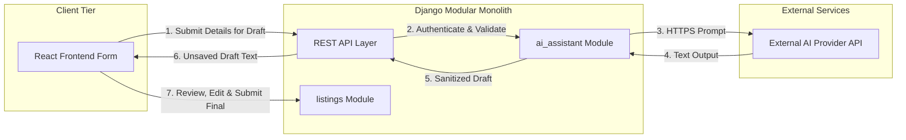
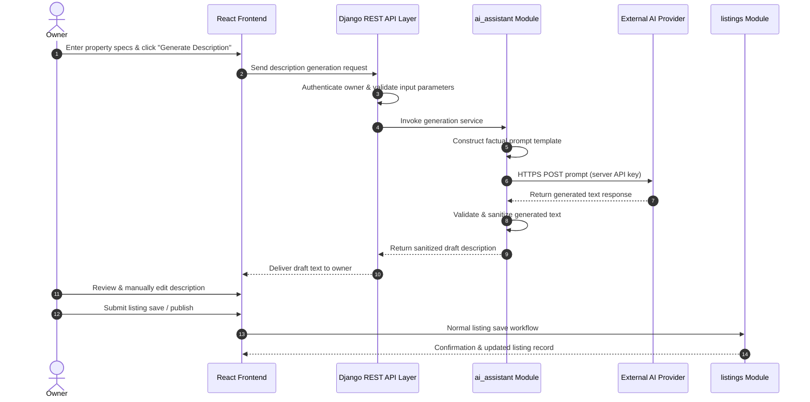
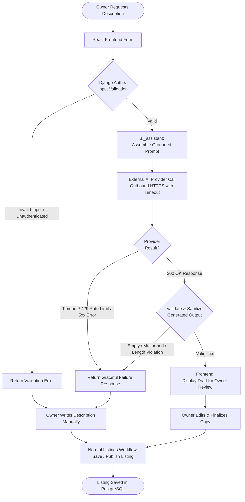

# Architecture: AI Integration Planning

## 1. AI Features and Scope

The platform integrates a lightweight, focused AI capability designed to streamline listing creation for property owners while maintaining strict editorial control.

### 1.1 Confirmed MVP Feature: AI-Powered Listing Description Generation
Property owners input structured property and unit details into the listing creation form and request an automated listing description. The system generates an engaging, factual draft that the owner can review, edit, or replace before publishing.

**Supported Input Attributes:**
- Property type (e.g., Apartment, Independent House, Villa)
- Location details (Locality, City, State)
- Space layout (Bedrooms, Bathrooms, Floor Number, Area in sq. ft.)
- Furnishing status (Unfurnished, Semi-furnished, Fully-furnished)
- Available amenities (e.g., Parking, Power Backup, Security, Balcony)
- Monthly rent and security deposit
- Optional owner notes (e.g., preferred tenant profile, pet policy, recent renovations)

### 1.2 Out of Scope for MVP (Future Enhancements)
The following capabilities are deliberately excluded from the initial release:
- Automated tenant-property matching or recommendation engines
- Conversational tenant chatbots or AI customer support
- RAG (Retrieval-Augmented Generation) pipelines over tenant agreements or local laws
- Dynamic rent pricing prediction algorithms
- Automated visual analysis of property photos
- Vector databases, fine-tuned models, or autonomous multi-agent systems

---

## 2. AI Integration Architecture

The AI subsystem operates as a stateless module within the Django modular monolith, strictly decoupled from core listing lifecycle and database operations.



### Component Responsibilities:
- **React Frontend**: Captures property attributes, triggers generation on demand, renders draft text inside an editable text area, and provides manual fallback if generation is unavailable.
- **Django REST API**: Authenticates the requesting user, validates ownership permissions, and validates attribute schemas before delegating to the service layer.
- **`ai_assistant` Module**: Encapsulates prompt construction, external provider API communication, timeouts, response validation, sanitization, and error handling. It owns no database tables.
- **External AI Provider**: Third-party language model API (e.g., OpenAI, Anthropic, or Gemini) that transforms structured prompts into coherent descriptive copy.
- **`listings` Module**: Manages all listing data, database persistence, status transitions (draft, published, unpublished), and publication approvals. The AI Assistant cannot create or publish listings directly.

---

## 3. AI Input → Processing → Output Flow



### Detailed Sequence Steps:
1. **Input Collection**: The owner inputs property and unit details into the listing form in the React frontend.
2. **Generation Request**: The owner clicks "Generate Description", dispatching an HTTPS request to Django.
3. **Authentication & Validation**: Django confirms the user is an authenticated owner and validates input fields against length and schema rules.
4. **Service Invocation**: The API layer invokes the internal `ai_assistant.services` interface.
5. **Prompt Assembly**: The service formats the validated specs into a standardized prompt template enforcing strict factual grounding.
6. **Outbound Provider Call**: The service sends an HTTPS request to the external AI provider using a secure server-side API key.
7. **Text Generation**: The external model generates a draft listing description.
8. **Sanitization & Response**: The `ai_assistant` module checks response integrity, truncates excess length, and returns the draft to the frontend.
9. **Editorial Review**: The owner reviews, modifies, or appends additional details to the copy in the frontend.
10. **Persistence**: The owner explicitly saves or publishes the listing through the standard `listings` module API.

---

## 4. Prompt Engineering

### 4.1 System & User Prompt Template

```text
You are a professional real estate copywriter. Generate an attractive, clear, and professional residential rental listing description based solely on the provided property specifications.

Strict Guidelines:
1. Grounding: Use ONLY the facts, amenities, and details explicitly provided below.
2. No Hallucinations: Do NOT invent nearby landmarks, travel times, neighborhood features, school districts, views, legal terms, or unlisted amenities.
3. Inclusivity: Do NOT use discriminatory, exclusionary, or steering language. Adhere to fair housing principles.
4. Transparency: Do NOT guarantee rental outcomes, utility costs, or future availability.
5. Formatting: Output ONLY the final listing description text. Do not include introductory notes, pleasantries, quotation marks, or meta-commentary.
6. Length: Keep the description between 100 and 180 words.

Property Details:
- Property Type: {property_type}
- Space: {bedrooms} BHK ({bathrooms} Bathrooms)
- Floor: {floor_number}
- Super Built-up Area: {area_sqft} sq. ft.
- Location: {locality}, {city}, {state}
- Furnishing Status: {furnishing_status}
- Monthly Rent: INR {monthly_rent}
- Security Deposit: INR {security_deposit}
- Amenities: {amenities_list}
- Additional Owner Notes: {additional_notes}
```

### 4.2 Sample Input & Representative Output

**Sample Input Payload:**
```json
{
  "property_type": "Apartment",
  "bedrooms": 2,
  "bathrooms": 2,
  "floor_number": 4,
  "area_sqft": 1150,
  "locality": "Indiranagar",
  "city": "Bengaluru",
  "state": "Karnataka",
  "furnishing_status": "Semi-furnished",
  "monthly_rent": 38000,
  "security_deposit": 150000,
  "amenities": ["Covered Car Parking", "Power Backup", "24/7 Security", "Balcony"],
  "additional_notes": "Ideal for families or working professionals. Available immediately."
}
```

**Representative Output (*Illustrative Sample — Not a Guaranteed Response*):**
> Located in Indiranagar, Bengaluru, this well-maintained semi-furnished 2 BHK apartment on the 4th floor offers 1,150 sq. ft. of comfortable living space. The home features two bedrooms, two modern bathrooms, and a private balcony providing pleasant ventilation. Key conveniences include dedicated covered car parking, 24/7 security, and reliable power backup for uninterrupted living. Available immediately, this residence is well-suited for families or working professionals seeking a quality rental home in a prime neighborhood. Offered at a monthly rent of INR 38,000 with a security deposit of INR 1,50,000. Contact today to schedule a viewing.

---

## 5. Validation and Error Handling



### 5.1 Failure Scenarios & Mitigations
- **Missing or Invalid Input**: Request serializers reject incomplete or malformed requests with `400 Bad Request` before invoking the external provider.
- **Provider Timeouts**: Outbound HTTP requests enforce a strict **8-second timeout**. If the provider fails to respond in time, the connection is aborted cleanly.
- **Provider Outages / 5xx Errors / Rate Limits (429)**: Caught by the adapter and logged. The API returns a clear, non-technical error: `"AI description service is temporarily unavailable. You can enter your description manually."`
- **Empty or Malformed Output**: Responses missing the expected completion text are rejected, triggering the manual fallback message.
- **Excessive Output Length**: The service truncates or rejects output exceeding 2,000 characters to prevent database field overflows and UI layout distortion.
- **Untrusted Input Principle**: All AI-generated text is treated as untrusted data; HTML tags and malicious formatting are stripped before sending the text to the client.
- **Manual Fallback Guarantee**: The description field in the listing form is never locked or blocked by the AI assistant. Owners can always type or modify descriptions manually.

---

## 6. Security, Privacy, and Cost Controls

1. **Credential Isolation**:
   - Provider API keys reside strictly in server environment variables or a cloud secret manager.
   - Keys are never bundled into the React build, sent to the browser, or committed to source control.
2. **Access Control**:
   - Only authenticated owners with permission to edit the target unit or property can trigger description generation.
3. **Data Minimization & Privacy**:
   - Only physical unit attributes, location, and amenity tags are included in the prompt.
   - User credentials, email addresses, phone numbers, tenant identities, and payment details are **strictly excluded**.
   - No claim is made that the external provider guarantees complete non-retention or zero training use unless specifically contracted under an enterprise BAA/DPA.
4. **Cost & Usage Controls**:
   - Rate limiting per owner account (e.g., maximum 10 generation requests per hour) prevents accidental cost spikes or abuse.
   - Fixed `max_tokens` limit on provider requests caps per-call token expenditure.
   - Short input string constraints prevent prompt injection and excessive context consumption.
5. **Information Leakage Prevention**:
   - Provider error stacks, internal API URLs, and raw upstream responses are logged internally but sanitized before returning to the frontend.

---

## 7. Technology Decisions

- **Configurable Provider Architecture**: The `ai_assistant` module implements a generic adapter interface, allowing seamless switching between OpenAI, Anthropic, or Google Gemini through environment configuration without changing business logic.
- **Synchronous MVP Processing**: Request/response is synchronous over HTTPS. Given the 8-second timeout and low MVP volume, introducing message brokers or asynchronous workers (e.g., Celery, Redis) is unnecessary overhead for the 3-week timeline.
- **No Vector Search or RAG**: Listing generation requires only structured unit attributes; retrieval-augmented generation and vector databases are not required.
- **No Autonomous Agents**: The AI is purely an assistive text generator. All decisions to persist, alter, or publish content remain exclusively with the human property owner.

---

## 8. Alignment with Existing Architecture

| Architecture Requirement | Implementation in AI Design |
| :--- | :--- |
| **Modular Monolith** | Contained entirely within `backend/apps/ai_assistant/`. |
| **Database Ownership** | Owns zero tables; persists nothing directly; hands sanitized text to `listings`. |
| **Inter-Module Communication** | Invoked strictly via Python service functions from the API/listings layer. |
| **Zero Heavy Infrastructure** | Operates over standard outbound HTTPS without message brokers or external caches. |
