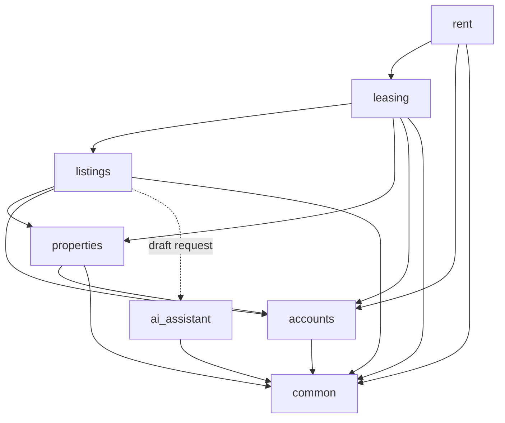

# Architecture: Module Boundaries

## 1. Purpose
Defines backend module boundaries, responsibilities, and dependency rules within a modular monolith, ensuring clean separation of concerns and preventing circular dependencies.

---

## 2. Module Responsibilities

| Module | Responsibilities |
| :--- | :--- |
| **`accounts`** | User authentication, profile management, and role-based authorization (Owner, Tenant, Admin). |
| **`properties`** | Properties, physical addresses, rental units, and ownership relationships. |
| **`listings`** | Unit listings, pricing, availability, publishing/unpublishing, and public search/discovery. |
| **`leasing`** | Rental applications, status reviews (approve/reject), tenancies, agreed rent, and dates. |
| **`rent`** | Rent charges, manual payment logging, outstanding balances, and payment history. |
| **`ai_assistant`** | Listing description draft generation; editable by owners; isolated AI provider integration. |
| **`common`** | Shared technical utilities and base models only. No domain business logic. |

---

## 3. Dependency Rules

1. **Unidirectional Dependencies**: Circular imports between apps are forbidden.
2. **Module Flow**:
   - `accounts` provides identity and authorization across all modules.
   - `properties` manages real estate assets independently of listings, leasing, or rent.
   - `listings` references units from `properties` and owners from `accounts`.
   - `leasing` references `listings`, `properties`, and `accounts` to manage applications and tenancies.
   - `rent` references tenancies from `leasing` and users from `accounts`.
   - `ai_assistant` is a stateless generator; it does not own listing records or database state.
   - `common` has zero domain dependencies; domain modules may use `common` for technical helpers.
3. **Service Layer**: Cross-module business actions must interact via explicit service functions rather than direct foreign model mutations.



---

## 4. Logical Boundaries in a Modular Monolith

All modules run inside a **single Django application** connected to a **single PostgreSQL database**:
- **Monolith Runtime**: Single deployment and process. No microservices, RPCs, or message brokers.
- **Single Database**: Tables share one database, namespaced cleanly by Django app.
- **Enforced Boundaries**: Separation is maintained via structured folder layouts and strict import discipline.

---

## 5. Proposed Backend Directory Structure

```text
backend/
├── apps/
│   ├── accounts/         # Identity, users, authorization
│   ├── properties/       # Properties, units, ownership
│   ├── listings/         # Listing management, search
│   ├── leasing/          # Applications, tenancies, dates
│   ├── rent/             # Rent charges, payments, balances
│   ├── ai_assistant/     # AI copy generation service
│   └── common/           # Shared base models and utilities
├── config/               # Django settings and root routing
├── manage.py
└── requirements.txt
```
