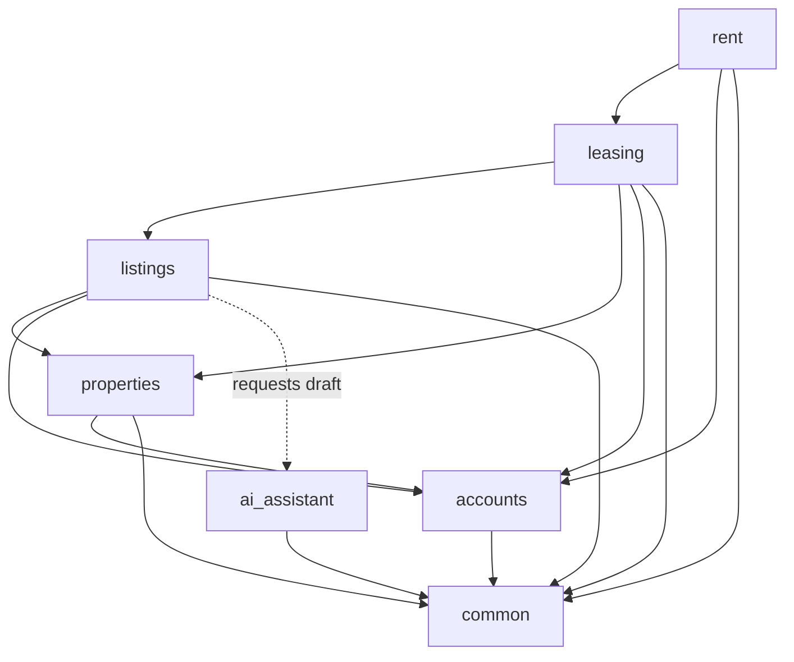

# Architecture: Module Boundaries

## 1. Purpose
This document defines the backend module boundaries, domain responsibilities, dependency rules, and organizational structure for the PropTech platform. Its objective is to enforce clean separation of concerns within a modular monolith architecture, preventing tight coupling and circular dependencies while keeping the system simple and maintainable.

---

## 2. Module Responsibilities

The backend is composed of seven distinct domain and infrastructure modules:

| Module | Core Responsibilities |
| :--- | :--- |
| **`accounts`** | • User authentication, registration, and session management.<br>• User profiles and role-based authorization (Owner, Tenant, Admin). |
| **`properties`** | • Property entities and physical address records.<br>• Rental unit definitions and unit-level details.<br>• Property and unit ownership relationships for the MVP. |
| **`listings`** | • Rental listings associated with specific units.<br>• Listing metadata, pricing, terms, and availability status.<br>• Listing lifecycle management (drafting, publishing, unpublishing).<br>• Public search, filtering, and listing discovery. |
| **`leasing`** | • Rental application submissions from prospective tenants.<br>• Application review workflows (status updates: approved, rejected).<br>• Tenancy agreement creation and lifecycle management.<br>• Tenancy terms, agreed rent amounts, and active dates. |
| **`rent`** | • Generation and tracking of rent charges for active tenancies.<br>• Logging and tracking of manual payment records.<br>• Calculation of tenant balances and payment history. |
| **`ai_assistant`** | • Generation of draft listing descriptions from unit and property data.<br>• Ensuring generated copy remains editable by owners prior to publishing.<br>• Encapsulation and isolation of AI provider integrations from core business logic. |
| **`common`** | • Shared technical infrastructure (e.g., base models, timestamp mixins, pagination utilities).<br>• Reusable cross-cutting technical helpers.<br>• *Strictly excluded from holding domain or business logic.* |

---

## 3. Dependency Rules

To maintain high cohesion and low coupling across the application, cross-module dependencies must respect the following rules:

1. **Unidirectional Flow & No Circular Dependencies**:
   - Modules must depend on lower-level or peer modules in a strictly unidirectional manner. Circular dependencies between Django apps are prohibited.
2. **Explicit Module Interactions**:
   - `accounts` acts as a foundational dependency, supplying identity and authorization across all modules.
   - `properties` manages real estate assets and does not depend on downstream transaction modules (`listings`, `leasing`, `rent`).
   - `listings` depends on `properties` (referencing units) and `accounts` (owner context).
   - `leasing` depends on `listings`, `properties`, and `accounts` to handle applications and establish tenancy agreements.
   - `rent` depends on `leasing` (referencing tenancies) and `accounts` (tenant/owner context). It tracks financial entries without managing property or listing lifecycle.
   - `ai_assistant` is a stateless service module that generates copy drafts. It receives property/unit parameters and returns text; it does not own listing models or database records.
   - `common` must never depend on any domain module. Domain modules may depend on `common` for technical primitives.
3. **Service Interfaces**:
   - When a business action spans multiple modules, interactions should occur through explicit service-layer functions or interfaces rather than direct cross-module model mutations.



---

## 4. Logical Boundaries in a Modular Monolith

All modules operate as logical boundaries within a **single Django application** backed by a **single PostgreSQL database**:
- **Not Microservices**: Modules run in the same runtime process and share one deployment pipeline. There are no distributed networks, RPCs, or message brokers.
- **Single Database**: All relational models live within the same PostgreSQL instance, while tables are organized logically by Django app namespaces.
- **Code Organization**: Logical modularity is achieved through explicit file structure and import hygiene, preserving development velocity while allowing individual domains to evolve cleanly.

---

## 5. Proposed Backend Directory Structure

Below is the proposed layout for the backend codebase:

```text
backend/
├── apps/
│   ├── accounts/         # Identity, user models, role authorization
│   ├── properties/       # Properties, units, ownership
│   ├── listings/         # Listing records, publishing, search
│   ├── leasing/          # Applications, tenancies, tenancy dates
│   ├── rent/             # Rent charges, manual payment logging, balances
│   ├── ai_assistant/     # AI listing description generator & provider adapter
│   └── common/           # Shared base models, mixins, technical utilities
├── config/               # Django project settings, root URLs, WSGI/ASGI
├── manage.py
└── requirements.txt
```
