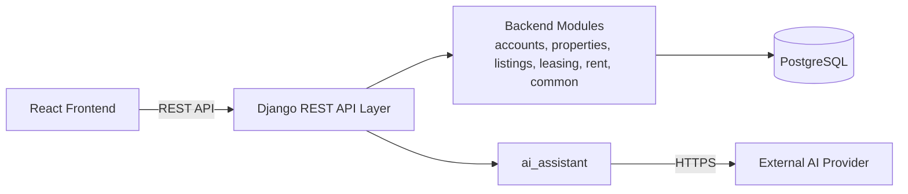

# Architecture: System Architecture

## 1. Overview
The platform is a **modular monolith** combining a React + TypeScript frontend and a Django REST Framework backend with a single PostgreSQL database. An external AI provider is integrated via the `ai_assistant` module. Communication happens over an OpenAPI-documented REST API.

---

## 2. System Components

- **Frontend**: React + TypeScript single-page app for Owners, Tenants, and Admin flows.
- **Backend**: Single Django application hosting all domain modules, business logic, and REST endpoints.
- **Database**: Single PostgreSQL database for all relational state, managed via Django migrations.
- **AI Provider**: External API accessed exclusively via the backend `ai_assistant` adapter.

---

## 3. Request Flow

1. **User Action**: User triggers an action in the React UI (e.g., submit application, record payment).
2. **API Call**: Frontend sends an HTTPS request with credentials (token/session) to Django.
3. **Auth & Validation**: DRF verifies identity, roles, and resource ownership; serializers validate input.
4. **Data Persistence**: Business services update PostgreSQL state via Django ORM.
5. **Response**: Django returns a JSON response; React updates the UI.

---

## 4. AI Request Flow

1. **Trigger**: Owner requests a description draft for a unit from the listing edit view.
2. **Backend Call**: Django's `listings` module calls `ai_assistant` with unit attributes.
3. **AI Generation**: `ai_assistant` queries the external AI API using server-side credentials and returns draft text.
4. **Draft Review**: Frontend displays draft text; owner reviews and edits the copy.
5. **Persist**: The finalized text is saved to PostgreSQL only when the owner saves or publishes the listing.

---

## 5. Security

- **Authentication**: Centralized session/token authentication in `accounts`.
- **Role-Based Authorization**: Endpoints restrict access strictly by role (Owner, Tenant, Admin).
- **Ownership Checks**: Mutative operations verify the user owns the target record.
- **Input Validation**: DRF serializers sanitize and validate all payload data.
- **Credential Protection**: AI provider keys and database secrets are stored strictly in server environment variables.

---

## 6. Deployment Overview

Three independently deployable components, operating without distributed infrastructure:
- **Frontend**: Static bundle served to browsers.
- **Backend API**: Monolithic Django container/process running all modules.
- **Database**: Managed PostgreSQL instance.
