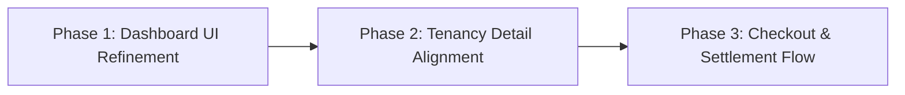

# Owner Financial Experience & Architecture Proposal

**Document:** `docs/audits/owner-financial-experience-proposal.md`  
**Date:** 2026-11-19 (Updated with Architecture Clarifications)  
**Target Audience:** Engineering, Product, and Design  
**Scope:** Architecture assessment, UI/UX design proposal, and technical clarifications for Rent & Payments in the Owner Workspace.

---

## 1. Executive Summary & Design Philosophy

Property owners are not accountants. When managing properties, owners typically want answers to three practical questions:
1. **Who has paid this month's rent, and who owes money?**
2. **How much tenant deposit money am I holding in custody?**
3. **When a tenant moves out, how do I settle damages and return their deposit?**

In traditional property management platforms, financial interfaces often clutter the experience with complex double-entry accounting terminology, merged debits and credits, and confusing ledger tables where security deposits are lumped together with monthly rent.

### The Core Design Principle: Two Independent Financial Buckets

To keep the PropTech platform simple, transparent, and robust for MVP, we strictly divide all financial activity into **two separate, unmerged concepts**:

```
┌────────────────────────────────────────────────────────────────────────┐
│                          OWNER FINANCES                                │
├───────────────────────────────────┬────────────────────────────────────┤
│           BUCKET 1: RENT          │     BUCKET 2: SECURITY DEPOSIT     │
│   (Recurring Operational Income)  │     (Fiduciary Custody / Escrow)   │
├───────────────────────────────────┼────────────────────────────────────┤
│ • Monthly Rent Charges            │ • Agreed Deposit in Lease          │
│ • Rent Received This Month        │ • Deposit Received / In Escrow     │
│ • Outstanding Rent Owed           │ • Deposit Pending Collection       │
│ • Overdue Rent Alerts             │ • Deductions for Move-out Damages  │
│ • Rent Payment Receipts           │ • Move-out Deposit Refund          │
└───────────────────────────────────┴────────────────────────────────────┘
```

By decoupling operational rent from fiduciary deposits across the data models, API endpoints, and user interface, we prevent cross-contamination (e.g., security deposits showing up as overdue rent) and give property owners complete clarity.

---

## 2. Current Financial Architecture Summary

### 2.1 Existing Database Models & Ledger Structure

The `apps.rent` module follows an append-only, transaction-safe architecture:

| Model | Purpose | Key Attributes & Constraints |
| :--- | :--- | :--- |
| **`RentCharge`** | Represents a debt or financial obligation tied to a `Tenancy`. | `charge_type` (`rent`, `security_deposit`, `late_fee`, `maintenance`, `utility`, `other`), `billing_period_start`, `billing_period_end`, `due_date`, `amount`, `status` (`unpaid`, `partially_paid`, `paid`, `waived`, `cancelled`). Constraint `uq_rent_charge_ten_type_period` enforces uniqueness on `(tenancy, charge_type, billing_period_start)`. |
| **`Payment`** | Represents an actual cash, UPI, bank transfer, or cheque receipt. | `tenancy`, `amount`, `currency`, `payment_method`, `status` (`pending`, `completed`, `failed`), `paid_at`, `transaction_reference`, `notes`. Partial unique index on non-empty `transaction_reference`. |
| **`PaymentAllocation`** | Links a `Payment` to a `RentCharge` within the same tenancy. | `payment`, `rent_charge`, `tenancy`, `allocated_amount`. Tenancy foreign keys ensure cross-tenancy contamination is impossible at the database constraint level. |
| **`PaymentRefund`** | Tracks return of funds for completed payments. | `payment`, `amount`, `reason`, `status` (`pending`, `completed`, `failed`), `processed_at`, `refund_reference`, `created_by`. Linked directly to `User` who approved the refund. |
| **`PaymentAllocationReversal`** | Append-only ledger recording allocation reversals caused by refunds. | `refund`, `allocation`, `rent_charge`, `tenancy`, `reversed_amount`. Preserves original allocation history permanently without mutating completed records. |
| **`Tenancy`** (`apps.leasing`) | Represents the lease agreement between owner and tenant. | `monthly_rent`, `security_deposit`, `rent_due_day`, `start_date`, `end_date`, `actual_move_in_date`, `actual_move_out_date`, `status` (`pending`, `confirmed`, `active`, `ended`, `cancelled`). |

### 2.2 Existing Backend Services & Workflows

1. **Charge Generation (`rent_service.py`):**
   - On tenancy activation (`activate_tenancy`): triggers `generate_initial_rent_charge`, creating an initial prorated rent charge and a separate `security_deposit` charge (if `security_deposit > 0`).
   - Monthly cycle (`generate_rent_charge_for_cycle` / `generate_due_rent_charges_batch`): batch task generating upcoming monthly rent charges based on `rent_due_day`.
2. **Payment Ingestion & Allocation (`payment_service.py` & `allocation_service.py`):**
   - `record_payment`: Records payment and initiates FIFO allocation against unpaid charges.
   - Accepts `target_charge_type`: ensures payments marked as `security_deposit` strictly settle deposit charges, while payments marked as `rent` strictly settle rent charges.
3. **Refunds & Ledger Integrity (`refund_service.py`):**
   - Refunds execute against a specific payment. If the payment was allocated to charges, `execute_refund_reversals` reverses allocations in reverse chronological order, correctly reopening charge balances.
4. **Security Deposit Aggregation (`list_security_deposits`):**
   - Queries deposit charges, allocations, reversals, and agreements per tenancy, returning agreed, received, outstanding, refunds, adjustments, and current net held.

---

## 3. Recommended Financial Business Rules

To maintain high data integrity and prevent owner confusion:

### 3.1 Rent Rules (Operational Income)
1. **Proration & Due Date:** The initial month is prorated based on tenancy `start_date`. Subsequent cycles run monthly from the 1st of each month or on the agreed `rent_due_day`.
2. **Overdue Calculation:** A rent charge is **Overdue** if and only if `charge_type == "rent"`, `due_date < today`, and `status in ("unpaid", "partially_paid")`.
3. **No Mixed Allocations:** A tenant's payment toward rent will never be applied to a deposit deficit, and rent surplus is never silently absorbed into deposits.
4. **Rent Outstanding:** Calculated solely as $\sum(\text{amount} - \text{effective\_allocations})$ for rent charges that are due or currently active.

### 3.2 Security Deposit Rules (Escrow Custody)
1. **Deposit Charge Generation:** Generated exactly once upon tenancy confirmation/activation.
2. **Deposit Outstanding vs Overdue:** An unpaid security deposit is labeled **"Pending Collection"**, **never "Overdue Rent"**. It does not trigger rental default notices.
3. **Deposit Held in Custody:**  
   $$\text{Deposit Held} = \text{Deposit Payments Received} - \text{Damage Deductions} - \text{Refunds Processed}$$
4. **Move-out Checkout Rule:** A tenancy cannot be marked fully closed/archived until the owner settles the deposit.

### 3.3 Strict MVP Scope Boundaries
- **No Advance Rent:** Advance rent schemes, complex amortization schedules, and multi-month prepayments are out of MVP scope.
- **No Complex Accounting Taxonomies:** Avoid terms like "General Ledger", "Credit Memo", "Accounts Receivable", and "Depreciation". Use human terms: **"Billed"**, **"Received"**, **"Pending"**, **"Overdue"**, and **"Refunded"**.

---

## 4. Key Architectural Clarifications & Verification

This section provides technical verification for the six critical implementation points raised prior to engineering execution.

### 4.1 Can Existing Models Safely Support Partial Security Deposit Refunds?

**Yes. The existing financial models fully and safely support partial security deposit refunds without mutating completed ledger history.**

#### Mechanism:
1. **`Payment`**: Holds the total deposit received (e.g. ₹50,000.00).
2. **`PaymentAllocation`**: Holds the initial allocation to the deposit `RentCharge` (e.g. ₹50,000.00).
3. **Partial Refund Processing (`PaymentRefund` & `PaymentAllocationReversal`)**:
   - When an owner processes a partial refund of ₹35,000.00, a new `PaymentRefund` record is created for `amount = 35000.00`, linking directly to `payment`, `created_by=owner`, and storing `reason`.
   - `refund_service.py:execute_refund_reversals` dynamically checks `get_payment_refundable_amount(payment)`. Since ₹50,000.00 ≥ ₹35,000.00, it validates successfully.
   - It creates an append-only `PaymentAllocationReversal` for `reversed_amount = 35000.00`.
   - The original `PaymentAllocation` (₹50,000.00) remains untouched in the database.
   - `PaymentAllocation.effective_amount` calculates dynamically as:
     $$\text{effective\_amount} = \text{allocated\_amount} - \sum(\text{reversals.reversed\_amount}) = 50,000 - 35,000 = 15,000.00$$
   - The remaining refundable ceiling on the payment is automatically reduced to ₹15,000.00 (`payment.amount - sum(successful_refunds)`).
   - If a second partial refund of ₹10,000.00 is initiated later, another `PaymentRefund` and `PaymentAllocationReversal` of ₹10,000.00 are appended, leaving a remaining refundable balance of ₹5,000.00.
4. **Safety & Ledger Purity**: Zero records are updated in place or overwritten; every partial refund is tracked as an immutable financial event.

---

### 4.2 How Will Itemised Deposit Deductions Be Recorded Permanently?

When a tenant moves out, an owner may deduct amounts for damages (e.g. ₹5,000 for painting, ₹3,000 for damaged fixtures). To guarantee permanent auditability (including **reason, amount, date, and approving owner**), we evaluate two potential data structures:

#### Option A: Zero-Migration Consolidated Settlement Charge + Detailed Audit Trail (Recommended for MVP)
- **Financial Settlement Record**: A `RentCharge` of `charge_type="maintenance"` (or `"other"`) is generated upon checkout for the total deduction amount (e.g. ₹8,000.00) with `due_date = actual_move_out_date` and `status = PAID`.
- **Itemised Breakdown**: The full itemised breakdown is stored within the settlement record description and mirrored in the `PaymentRefund.reason`:
  `"Checkout settlement deductions: Painting (₹5,000), Broken fixture (₹3,000). Approved by Owner on 2026-11-19."`
- **Approving Owner**: Preserved directly in `PaymentRefund.created_by` (Foreign Key to `User`) and in the tenancy checkout event.
- **Auditability**: Permanent and immutable. Does not require new database tables or schema migrations.

#### Option B: Relational Line-Item Model (`TenancyDepositDeduction`)
- If the product strictly requires each deduction item to be an independent relational database row with separate item-level deletion/editing in the UI:
  ```python
  class TenancyDepositDeduction(BaseModel):
      tenancy = models.ForeignKey("leasing.Tenancy", on_delete=models.PROTECT, related_name="deposit_deductions")
      amount = models.DecimalField(max_digits=12, decimal_places=2)
      reason = models.CharField(max_length=255)
      category = models.CharField(max_length=50) # 'maintenance', 'utility', 'cleaning'
      deducted_date = models.DateField(default=timezone.localdate)
      approved_by = models.ForeignKey(settings.AUTH_USER_MODEL, on_delete=models.PROTECT)
  ```
- **Constraint Check**: As detailed in Section 4.4, `RentCharge` has constraint `uq_rent_charge_ten_type_period: (tenancy, charge_type, billing_period_start)`. Creating multiple separate `RentCharge` rows of type `maintenance` on the same move-out date would violate this constraint. Therefore, true relational multi-row itemised deductions **cannot** be stored as multiple `RentCharge` rows; they require either Option A (consolidated settlement charge) or Option B (new model + migration).

---

### 4.3 Checkout Settlement Calculations

The end-of-tenancy checkout settlement calculates the financial position in a single deterministic pass:

$$\begin{aligned}
\text{1. Deposit Received} &= \sum \text{Effective Allocations to Deposit Charges for this Tenancy} \\
\text{2. Total Deductions} &= \sum \text{Approved Itemised Deductions} \\
\text{3. Net Refundable Amount} &= \max\left(0, \text{Deposit Received} - \text{Total Deductions}\right) \\
\text{4. Refund Completed} &= \sum \text{Completed PaymentRefund amounts for this Tenancy's Deposit} \\
\text{5. Remaining Deposit Held} &= \max\left(0, \text{Deposit Received} - \text{Total Deductions} - \text{Refund Completed}\right)
\end{aligned}$$

#### Settlement Validation Invariant:
$$\text{Total Deductions} + \text{Refund Completed} \le \text{Deposit Received}$$
- An owner cannot deduct more than the deposit received. If damages exceed the deposit, the deduction is capped at `Deposit Received` (any excess would be a separate damage bill/claim).
- The checkout modal displays all 5 values in real time as the owner enters deductions.

---

### 4.4 Database Migration Assessment

**Verdict: A database migration is OPTIONAL, depending on whether the product accepts Option A (consolidated itemisation) or insists on Option B (relational line items).**

1. **If using Option A (Consolidated Settlement via Existing Models):**
   - **Zero migrations required.**
   - Uses `RentCharge` (with `charge_type='maintenance'` or `'other'`), `PaymentRefund` (which already has `created_by`, `amount`, `reason`, `processed_at`), and `PaymentAllocationReversal`.
   - Fully satisfies auditability and financial integrity.

2. **If using Option B (Dedicated Relational Table for Deductions):**
   - **1 migration required.**
   - Table: `tenancy_deposit_deductions` (or `deposit_deductions`).
   - Requires adding the table to `database-erd.version.02.dbml` and creating a Django migration in `apps/leasing` or `apps/rent`.

> [!IMPORTANT]  
> **Recommendation:** We recommend **Option A for MVP**. It delivers complete auditability, records approving owner and timestamp, avoids database schema drift from approved DBML, and requires zero migrations. If multi-line relational queryability is demanded post-MVP, Option B can be migrated without changing business calculation logic.

---

### 4.5 Calculation Separation: Rent Pending, Upcoming Rent, and Overdue Rent

To eliminate ambiguity, rent charges (`charge_type == "rent"`) are partitioned into three mutually exclusive categories based on the current evaluation date ($T = \text{timezone.localdate()}$):

| Classification | Inclusion Criteria | Formula | Meaning |
| :--- | :--- | :--- | :--- |
| **Overdue Rent** | `due_date < T`<br>`status in ("unpaid", "partially_paid")` | $\sum(\text{amount} - \text{effective\_allocations})$ | Rent whose deadline has passed without full payment. Highlights in red as active arrears. |
| **Rent Pending** | `due_date >= T`<br>`billing_period_start <= T`<br>`status in ("unpaid", "partially_paid")` | $\sum(\text{amount} - \text{effective\_allocations})$ | The current active cycle's rent that is billed and awaiting payment, but not yet past its due date. |
| **Upcoming Rent** | `billing_period_start > T`<br>`status in ("unpaid", "partially_paid")` | $\sum(\text{amount} - \text{effective\_allocations})$ | Future cycles generated ahead of time (e.g. 7 days before next month). Informative only; never counted as current debt. |
| **Total Rent Outstanding** | Billed rent due or currently active | $\text{Overdue Rent} + \text{Rent Pending}$ | Excludes future/upcoming cycles. |

---

### 4.6 Risk Analysis & Safeguards

#### Risk 1: Double Refunds
- **Vulnerability**: An owner accidentally clicking "Refund" twice, or two concurrent API requests processing refunds against the same payment.
- **Safeguards in Codebase**:
  1. `refund_service.py` executes inside `@transaction.atomic` and applies `select_for_update()` on the parent `Payment` row.
  2. The service enforces:
     $$\text{requested\_amount} \le \text{payment.amount} - \sum_{\text{status}=\text{completed}}(\text{PaymentRefund.amount})$$
     If requested amount exceeds remaining refundable amount, it raises `RefundValidationError` and aborts.
  3. Client-side button disables immediately on click with loading spinner (`isPending`).

#### Risk 2: Duplicate Deductions
- **Vulnerability**: An owner submitting deductions multiple times during checkout, or deducting more than the deposit received.
- **Safeguards**:
  1. The checkout action transitions the tenancy from `ACTIVE` to `ENDED`. Once `status == ENDED`, the checkout settlement endpoint rejects subsequent settlement requests (`TenancyStateError: "Tenancy is already ended"`).
  2. The settlement service strictly validates:
     $$\text{deduction\_amount} \le \text{deposit\_received} - \text{prior\_deductions}$$
  3. Deductions cannot be recorded on a tenancy that has no active deposit payment.

#### Risk 3: Cross-Owner Access
- **Vulnerability**: Owner A maliciously passing Owner B's `tenancy_id`, `charge_id`, or `payment_id` to read or record payments/refunds.
- **Safeguards**:
  1. **Strict Queryset Filtering**: `list_user_rent_charges`, `list_security_deposits`, and `get_owner_rent_summary` filter by `tenancy__property__owner=request.user`.
  2. **Service Verification**: `_verify_property_owner(property, user)` in `tenancy_service.py` and `_verify_user_can_manage_refunds(user, payment)` in `refund_service.py` reject unauthorized requests with `PermissionDenied` / `RefundPermissionError` (HTTP 403 Forbidden).
  3. **Role Spoofing Block**: Authenticated users who do not possess verified owner capability cannot query owner resources by appending `?role=owner`.

---

## 5. Proposed UI/UX Architecture & Layout

### 5.1 Two Levels of Financial Visibility

Owners manage properties in two distinct mindsets:
1. **Portfolio-Level View (`/app/owner/rent`):** "How is my whole rental business doing right now?" (Global cash flow, across all properties).
2. **Tenancy-Level View (`/app/owner/tenancies/:id`):** "What is the financial relationship with this specific tenant?" (Lease terms, month-by-month rent breakdown, and move-out deposit settlement).

### 5.2 Top-Level Workspace: `/app/owner/rent`

#### A. Dual-Zone Financial Summary Banner
A clear 2-zone card row at the top of the page that visually separates **Monthly Rent Performance** from **Security Deposits Held**:

```
ZONE A: MONTHLY RENT (Operational)           ZONE B: DEPOSITS (Escrow Custody)
┌──────────────┐ ┌──────────────┐ ┌──────────────┐   ┌──────────────┐ ┌──────────────┐
│ Rent Collected│ │Rent Pending │ │ Overdue Rent │   │Deposits Held │ │Pending Collec│
│   ₹1,85,000   │ │   ₹25,000   │ │   ₹12,000    │   │  ₹3,50,000   │ │   ₹50,000    │
│  This Month   │ │ 2 Tenancies │ │  1 Tenancy   │   │  in Custody  │ │ 1 Move-in    │
└──────────────┘ └──────────────┘ └──────────────┘   └──────────────┘ └──────────────┘
```

#### B. Three Human-Centric Tabs

1. **Tab 1: Rent Ledger (Default Tab)**
   - Shows monthly rent charges grouped or filterable by month and property.
   - Columns: `Month / Cycle`, `Property & Tenant`, `Due Date`, `Billed`, `Paid`, `Balance`, `Status` (`Paid`, `Partial`, `Overdue`), `Action` (`Record Payment`).
   - Clear visual indicator: Red badge for overdue rent; green badge for paid.

2. **Tab 2: Security Deposits**
   - Shows one clear summary row per tenancy.
   - Columns: `Property & Tenant`, `Agreed Deposit`, `Collected`, `Pending Collection`, `Deductions`, `Refunded`, `Net Held`, `Status`, `Action` (`Collect Deposit` or `Settle / Refund`).
   - Statuses: `Fully Held` (Green), `Pending Collection` (Amber), `Settled / Refunded` (Gray).

3. **Tab 3: Payment Transactions (Audit Trail)**
   - Chronological stream of all incoming money and outgoing refunds.
   - Combines payments and refunds into a single timeline so owners don't need a separate "Refunds" tab.
   - Columns: `Date`, `Type` (`Rent Payment`, `Security Deposit`, `Refund`), `Property & Tenant`, `Method / Reference`, `Amount`, `Status`, `Receipt / Details`.

---

## 6. UI Text Wireframes

### Wireframe 1: Owner Rent & Payments Dashboard (`/app/owner/rent`)

```
========================================================================================================
 Rent & Payments                                                        [+ Record Rent] [+ Record Deposit]
========================================================================================================

 [ MONTHLY RENT PERFORMANCE ]                         [ SECURITY DEPOSITS IN ESCROW ]
 ┌─────────────────┐┌─────────────────┐┌─────────────────┐   ┌─────────────────┐┌─────────────────┐
 │ Rent Collected  ││ Rent Pending    ││ Overdue Rent ⚠️ │   │ Deposits Held   ││ Pending Deposit │
 │ ₹1,85,000       ││ ₹25,000         ││ ₹12,000         │   │ ₹3,50,000       ││ ₹50,000         │
 │ 4 Paid this mo  ││ 1 Tenancy       ││ 1 Tenancy       │   │ In Bank Account ││ 1 Tenancy       │
 └─────────────────┘└─────────────────┘└─────────────────┘   └─────────────────┘└─────────────────┘

 ───────────────────────────────────────────────────────────────────────────────────────────────────────
   [ Rent Ledger (4) ]     [ Security Deposits (3) ]     [ Payment Transactions (8) ]
 ───────────────────────────────────────────────────────────────────────────────────────────────────────

 Filters: [ All Properties ▼ ] [ Status: All ▼ ] [ Month: November 2026 ▼ ]          [ Search Tenant... ]

 ┌─────────────────────────────────────────────────────────────────────────────────────────────────────┐
 │ #  Property & Tenant         Billing Period    Due Date     Billed     Paid      Balance   Status   │
 ├─────────────────────────────────────────────────────────────────────────────────────────────────────┤
 │ 1  New Mod                   Nov 1 - Nov 30   12 Nov 2026  ₹59,280   ₹59,280     ₹0.00   [ PAID ] │
 │    Tenant: Breaker                                                                                  │
 ├─────────────────────────────────────────────────────────────────────────────────────────────────────┤
 │ 2  Sample one for all        Nov 12 - Nov 30  12 Nov 2026  ₹22,800     ₹0.00   ₹22,800  [OVERDUE] │
 │    Tenant: Breaker                                                              [ Record Payment ]  │
 ├─────────────────────────────────────────────────────────────────────────────────────────────────────┤
 │ 3  Palm Villa                Nov 1 - Nov 30   05 Nov 2026  ₹45,000   ₹45,000     ₹0.00   [ PAID ] │
 │    Tenant: Alice Smith                                                                              │
 └─────────────────────────────────────────────────────────────────────────────────────────────────────┘
 Showing 3 of 3 charges                                                                 Rows per page 10
```

---

### Wireframe 2: Tenancy Detail Page Financial Section (`/app/owner/tenancies/:id`)

```
========================================================================================================
 Tenancy: New Mod — Breaker (ACTIVE)                                      [ Checkout / End Tenancy ]
========================================================================================================

 ┌─ FINANCIAL STATUS ──────────────────────────────────────────────────────────────────────────────────┐
 │                                                                                                     │
 │  ● RENT: Up to Date (₹59,280/mo)                  ● SECURITY DEPOSIT: Fully Held (₹1,97,600)        │
 │    Last payment received: 14 Nov 2026 (UPI)         Held in custody since 12 Nov 2026                │
 │    Next rent due: 01 Dec 2026 (Day 1 of month)      Status: No deductions                             │
 │                                                                                                     │
 └─────────────────────────────────────────────────────────────────────────────────────────────────────┘

 [ Rent Charges History ]    [ Deposit & Refunds ]    [ All Payments ]             [+ Record Payment]

 ┌─────────────────────────────────────────────────────────────────────────────────────────────────────┐
 │ Cycle / Period        Due Date      Billed Amount    Paid Amount    Outstanding    Status    Receipt│
 ├─────────────────────────────────────────────────────────────────────────────────────────────────────┤
 │ Nov 2026 (Prorated)  12 Nov 2026      ₹59,280.00      ₹59,280.00        ₹0.00      [PAID]   [View] │
 └─────────────────────────────────────────────────────────────────────────────────────────────────────┘
```

---

### Wireframe 3: Simplified Record Payment Modal

```
┌────────────────────────────────────────────────────────────────────────────────┐
│ Record Payment                                                             [X] │
├────────────────────────────────────────────────────────────────────────────────┤
│ 1. Select Tenancy *                                                            │
│    [ Sample one for all — Breaker (Active)                                  ▼] │
│                                                                                │
│ 2. What is this payment for? *                                                 │
│    (•) Monthly Rent (Pending: ₹22,800.00)                                      │
│    ( ) Security Deposit (Pending: ₹1,05,000.00)                                │
│                                                                                │
│ 3. Amount Received (₹) *                                                       │
│    [ 22,800.00                                                               ] │
│    [Quick fill: Full Pending Amount (₹22,800.00)]                              │
│                                                                                │
│ 4. Payment Method *                          5. Payment Date                   │
│    [ UPI                                 ▼]     [ 11/19/2026                📅] │
│                                                                                │
│ 6. Reference / Transaction ID (Optional)                                       │
│    [ UPI/IMPS/Bank Reference                                                 ] │
│                                                                                │
│ 7. Notes (Optional)                                                            │
│    [ e.g. GPay screenshot verified                                           ] │
│                                                                                │
├────────────────────────────────────────────────────────────────────────────────┤
│                                                     [ Cancel ] [ Record Payment ]
└────────────────────────────────────────────────────────────────────────────────┘
```

---

### Wireframe 4: Move-out Checkout & Deposit Settlement Modal

```
┌────────────────────────────────────────────────────────────────────────────────┐
│ Checkout & Settle Security Deposit                                         [X] │
├────────────────────────────────────────────────────────────────────────────────┤
│ Tenancy: Palm Villa — Alice Smith                                              │
│ Move-out Date: 30 Nov 2026                                                     │
│                                                                                │
│ 1. Security Deposit Summary                                                    │
│    Total Deposit Held in Escrow:                   ₹50,000.00                  │
│                                                                                │
│ 2. Deductions for Damages / Cleaning (Optional)                                │
│    Deduction Amount (₹): [ 5,000.00   ]                                        │
│    Reason:               [ Painting repair and deep cleaning                 ] │
│                                                                                │
│ 3. Calculated Refund Amount                                                    │
│    Net Refund to Tenant:                           ₹45,000.00                  │
│                                                                                │
│ 4. Refund Payment Details                                                      │
│    Payment Method: [ Bank Transfer (NEFT)                                   ▼] │
│    Reference ID:   [ HDFC-REF-9923812                                        ] │
│                                                                                │
│ [X] Send move-out settlement receipt and statement to tenant via email.        │
├────────────────────────────────────────────────────────────────────────────────┤
│                                          [ Cancel ] [ Complete Checkout & Refund ]
└────────────────────────────────────────────────────────────────────────────────┘
```

---

## 7. Proposed User Workflows

### Workflow A: Monthly Rent Tracking & Collection
1. **Automated Cycle Generation:** On the 1st of every month (or `rent_due_day`), the backend generates a `RentCharge` of type `rent` for each active tenancy.
2. **Dashboard Review:** The owner opens `/app/owner/rent`. If rent is pending, it displays in **Rent Pending**. If the due date passes without payment, it automatically highlights under **Overdue Rent**.
3. **Recording Offline Rent:** Owner clicks `Record Payment` next to the overdue charge. The modal pre-fills the tenant, property, charge type (`rent`), and exact balance due.
4. **Instant Reconciliation:** The backend FIFO allocation marks the charge `paid`. The dashboard immediately deducts the amount from *Outstanding Rent* and adds it to *Rent Collected*.

### Workflow B: Security Deposit Ingestion at Move-In
1. **Tenancy Activation:** When an application is approved and confirmed, the owner clicks `Activate Tenancy`.
2. **Deposit Charge Created:** A single `RentCharge` of type `security_deposit` is automatically created with the exact agreed amount.
3. **Recording Deposit:** The owner receives the deposit transfer (UPI or bank) and logs it via `Record Payment` with `Payment Type = Security Deposit`.
4. **Escrow Custody:** The deposit appears under **Security Deposits Held** on both the dashboard and the tenancy details page.

### Workflow C: End-of-Tenancy Checkout & Settlement
1. **Initiate Move-Out:** When a tenant vacates, the owner clicks `Checkout / End Tenancy` from the Tenancy Details page.
2. **Deposit Inspection:** The modal displays the ₹ held. If there are property damages, the owner enters the deduction and itemized reason.
3. **Refund Processing:** The remaining balance is marked for refund.
4. **Settlement Closure:** The tenancy moves to `ENDED`, the property status reverts to `AVAILABLE`, and the security deposit row marks status as `SETTLED`.

---

## 8. Prioritised Implementation Plan



### Phase 1: Dashboard UI Refinement (High Priority)
- Refactor top KPI summary cards into two distinct visual zones: **Rent Performance (3 cards)** and **Deposit Custody (2 cards)**.
- Consolidate dashboard navigation into 3 clean tabs:
  1. `Rent Ledger`
  2. `Security Deposits`
  3. `Payment Transactions` (merged payments & refunds stream).
- Add default date selection to "Today" in `RecordPaymentModal.tsx` with a prominent pending balance button.

### Phase 2: Tenancy Detail Page Financial Alignment (Medium Priority)
- Update `OwnerTenancyDetailPage.tsx` to display the dual financial health badges:
  - Rent Status badge (`Up to date` / `Overdue`)
  - Security Deposit badge (`Held in Escrow: ₹X` / `Pending: ₹Y`).
- Provide sub-tabs inside Tenancy Details: `Rent History`, `Security Deposit`, and `Payments & Receipts`.

### Phase 3: Checkout & Settlement Workflow (High Value)
- Extend `TenancyLifecycleModal` when action is `end` (Checkout) to show the deposit settlement option:
  - Displays currently held deposit.
  - Allows entering deductions with a reason.
  - Automatically calculates and executes the refund via `refund_service.py`.

---

## 9. Conclusion & Final Recommendation

### Why this proposal will be dramatically easier for property owners:

1. **Zero Financial Mental Overhead:** Owners will never wonder whether a ₹50,000 figure is rent or deposit. The visual separation makes it impossible to mistake tenant custody money for spendable rental income.
2. **Clear Action Triggers:** When rent is late, it appears in red under **Overdue Rent** with a direct "Record Payment" button. When a deposit is pending from a new tenant, it is clearly flagged as "Pending Collection".
3. **No Hidden Ledgers:** Rather than forcing users into accounting reports, every number on the dashboard maps 1:1 with an active lease agreement and bank transaction.
4. **Architectural Safety:** Builds entirely on top of the battle-tested, append-only FIFO engine and composite foreign key safety already implemented in the backend, requiring zero database migrations under Option A.
