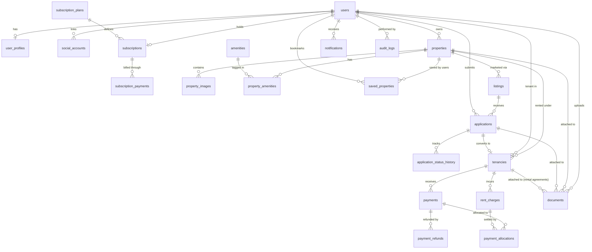

# Database Design

## Overview

The PropTech platform uses **PostgreSQL** as its relational database. The database is shared by the Django modular monolith, with each module maintaining strict ownership over its domain tables.

- **Primary keys:** UUID (generated via `gen_random_uuid()`)
- **Timestamps:** ISO 8601 timestamps with timezone (`timestamptz`), automatically populated on record creation and updates
- **Currency:** INR (`char(3)` default `'INR'`), with `numeric(12,2)` / `numeric(10,2)` decimal fields for monetary precision
- **Architecture:** Property-centric model where one property represents one independently rentable real estate asset (standalone units and unit amenities are eliminated)
- **Relationships & Constraints:** Foreign keys, composite unique indexes, partial unique indexes, check constraints, and PostgreSQL exclusion constraints maintain strict data integrity

## Entity Relationship Diagram

- [View ERD Diagram](diagrams/database-erd.png)
- [Open DBML Source](diagrams/database-erd.version.02.dbml)

## Database Entities & Modules

The current database design comprises **22 tables** partitioned across seven functional domain areas:

| Area | Tables | Purpose |
|---|---|---|
| **Accounts** | `users`, `user_profiles`, `social_accounts` | User authentication, identity credentials, 1:1 user profile details, and linked OAuth identity providers |
| **Properties & Amenities** | `properties`, `property_images`, `amenities`, `property_amenities` | Property-centric physical assets (residential and commercial), photo gallery, and catalogued amenities |
| **Listings** | `listings`, `saved_properties` | Public marketing listings, asking terms, approval workflows, and saved properties |
| **Leasing** | `applications`, `application_status_history`, `tenancies` | Tenant rental applications, append-only status audit trails, and agreed tenancy lifecycles |
| **Rent & Ledger** | `rent_charges`, `payments`, `payment_refunds`, `payment_allocations` | Rent charge schedules, recorded payments, refund tracking, and payment-to-charge allocations |
| **Subscriptions** | `subscription_plans`, `subscriptions`, `subscription_payments` | Owner SaaS subscription tiers, property quota tracking, active subscriptions, and subscription billing history |
| **Supporting Services** | `notifications`, `audit_logs`, `documents` | In-app user notifications, immutable system audit logs, and centralized document metadata (including tenancy rental agreements) |

The ownership, operational boundaries, and dependency rules of each module are defined in [Module Boundaries](module-boundaries.md).

---

## Detailed Entity Specifications

### 1. Accounts
- **`users`**: Custom user model subclassing `AbstractBaseUser` and `PermissionsMixin`. Uses normalized, case-insensitive `email` as the sole unique `USERNAME_FIELD` (eliminating `username`). Contains authentication flags (`is_active`, `is_staff`, `is_superuser`), names, `last_login`, and `email_verified_at`.
- **`user_profiles`**: 1:1 relationship with `users` (`user_id` unique). Stores optional profile details including `phone_number`, `profile_image`, and `bio`.
- **`social_accounts`**: Federated third-party identity connections (such as Google OAuth 2.0). Linked to `users` via `user_id`. Tracks `provider` (e.g., `'google'`) and `provider_user_id` (Google's unique `sub` identifier). Enforces uniqueness on `(provider, provider_user_id)` to prevent duplicate identity mapping and `(user_id, provider)` to restrict one account per provider per user.

### 2. Properties & Amenities (Central Rentable Asset)
- **`properties`**: The central independently rentable entity.
  - **Ownership:** Linked to `users` via `owner_id`.
  - **Category & Type:** Strict separation between `category` (`'residential'`, `'commercial'`) and `property_type`:
    - Residential types: `'independent_house'`, `'villa'`, `'apartment'`, `'studio_apartment'`, `'other'`.
    - Commercial types: `'office'`, `'shop'`, `'showroom'`, `'warehouse'`, `'other'`.
  - **Physical Specs:** `built_up_area` (sq ft, > 0), `furnishing_status` (`'unfurnished'`, `'semi_furnished'`, `'fully_furnished'`), `parking_spaces` (default 0), and `parking_details`. Residential properties require `bedrooms` and `bathrooms` (>= 0) before publishing; commercial properties allow these fields to remain `NULL`.
  - **Location & Coordinates:** Full address hierarchy (`address_line_1`, `address_line_2`, `landmark`, `locality`, `city`, `district`, `state`, `pin_code`, `country_code`). Indian PIN codes are validated (6 digits). Map coordinates (`latitude`, `longitude`) must both be `NULL` (in draft) or both populated (required before publishing).
  - **Pricing Architecture Decision:** Asking terms (`monthly_rent`, `security_deposit`, `available_from`) belong exclusively to `listings`, while agreed contract terms belong to `tenancies`. Asking terms are deliberately **not** duplicated on `properties` to prevent data drift between physical assets and marketing listings.
- **`property_images`**: Authoritative photo gallery for property management and public marketing listings. Eliminates redundant `listing_images`. Supports `display_order` and enforces at most one primary image per property via a PostgreSQL partial unique index (`is_primary = true`).
- **`amenities`**: Centralized catalogue covering residential and commercial features across controlled categories: `'building'`, `'safety'`, `'hvac'`, `'power_backup'`, `'connectivity'`, `'recreation'`, `'appliance'`, `'accessibility'`.
- **`property_amenities`**: Many-to-many join table between `properties` and `amenities` with a unique constraint on `(property_id, amenity_id)`.

### 3. Listings & Saved Properties
- **`listings`**: Marketing representation of a rentable property.
  - Linked to `properties` via `property_id`.
  - Stores marketing title, description, `monthly_rent` (>= 0), `security_deposit` (>= 0), `available_from`, and listing `status` (`'draft'`, `'published'`, `'paused'`, `'closed'`).
  - **Listing Moderation:** Tracks `review_status` (`'pending'`, `'approved'`, `'rejected'`), `reviewed_by_id`, `reviewed_at`, and `rejection_reason`. Public search results require `status = 'published'` and (when mandatory approval is enabled) `review_status = 'approved'`.
  - **Single Open Listing Rule:** Enforces at most one open listing per property via a PostgreSQL partial unique index where `status IN ('draft', 'published', 'paused')`.
- **`saved_properties`**: Allows authenticated users/tenants to bookmark properties for future reference, with a unique constraint on `(user_id, property_id)`.

### 4. Rental Applications & Status History
- **`applications`**: Prospective tenants (`applicant_id`) apply directly to an open `listing_id`.
  - Statuses: `'submitted'`, `'under_review'`, `'approved'`, `'rejected'`, `'withdrawn'`.
  - Enforces one application per applicant per listing via unique constraint `(listing_id, applicant_id)`.
  - Captures optional applicant message, review timestamp, and reviewer ID.
- **`application_status_history`**: Append-only audit record created inside the same transaction whenever an application transitions status (`previous_status`, `new_status`, `changed_by_id`, `change_reason`, `created_at`).

### 5. Tenancies (Rental Lifecycle)
- **`tenancies`**: Formed when an approved application is converted into an active tenancy (or created directly by the owner).
  - References `property_id`, `tenant_id`, and an optional unique `application_id`.
  - **Contract Terms:** Agreed `start_date`, optional `end_date` (>= `start_date`), agreed `monthly_rent` (>= 0), `security_deposit` (>= 0), and `rent_due_day` (between 1 and 28).
  - **Statuses:** `'pending'`, `'confirmed'`, `'active'`, `'ended'`, `'cancelled'`.
  - **Move In/Out:** Records `actual_move_in_date` and `actual_move_out_date`.
  - **Application Integrity:** When `application_id` is supplied, it must belong to `tenant_id` and reference a listing for the same `property_id`.
  - **Overlapping Tenancy Prevention (PostgreSQL Exclusion Constraint):** Prevents overlapping date ranges for confirmed and active tenancies on the same property using a PostgreSQL GiST exclusion constraint (`excl_tenancy_property_no_overlap` over `daterange(start_date, COALESCE(end_date, 'infinity'), '[]')` WHERE `status IN ('confirmed', 'active')`).

### 6. Rent Charges, Payments, Refunds & Allocations
- **`rent_charges`**: Financial obligations linked to `tenancy_id`.
  - Tracks `charge_type` (e.g. `'rent'`, `'maintenance'`), `billing_period_start`, `billing_period_end`, `due_date`, `amount` (> 0), `status` (`'unpaid'`, `'partially_paid'`, `'paid'`, `'waived'`, `'cancelled'`), and optional description.
  - Unique constraint `(tenancy_id, charge_type, billing_period_start)` prevents duplicate charges of the same type within the same billing period.
  - Composite unique index `(id, tenancy_id)` supports multi-column foreign key referential integrity.
- **`payments`**: Payment receipts linked to `tenancy_id`.
  - Records `amount` (> 0), `currency`, `payment_method`, `transaction_reference`, `status` (`'pending'`, `'completed'`, `'failed'`), `paid_at`, and notes.
  - Partial unique index on `transaction_reference` prevents duplicate non-cash reference numbers.
  - Composite unique index `(id, tenancy_id)` supports multi-column foreign key referential integrity.
- **`payment_refunds`**: Tracks return of funds for completed payments.
  - Linked to `payment_id`, storing `amount` (> 0), `currency`, `reason`, `status`, external `refund_reference`, `processed_at`, and `created_by`.
  - Enforces that total successful refunds must not exceed the original payment amount, and refunds must belong to the same tenancy as the parent payment.
- **`payment_allocations`**: Settles specific rent charges using received payments.
  - References `payment_id`, `rent_charge_id`, and `tenancy_id` (denormalized by design).
  - Enforces tenancy matching across payment and charge via composite foreign keys:
    - `(payment_id, tenancy_id) REFERENCES payments(id, tenancy_id)`
    - `(rent_charge_id, tenancy_id) REFERENCES rent_charges(id, tenancy_id)`
  - Unique constraint on `(payment_id, rent_charge_id)` prevents redundant allocation pairs.
  - Handled atomically: locks payment and charge rows, ensures `allocated_amount` <= unallocated payment balance and <= outstanding charge balance, and updates charge statuses accordingly.

### 7. Subscriptions & Owner Property Quotas
- **`subscription_plans`**: Defines platform SaaS tiers for property owners.
  - Fields: `name`, `code` (unique), `min_properties` (>= 1), `max_properties` (NULL indicates unlimited), `monthly_price` (INR, NULL indicates custom enterprise pricing), `currency`, `trial_duration_months` (default 3), `is_active`.
  - **Plan Tiers:**
    - *Starter:* 1–5 properties, 399.00 INR/month.
    - *Growth:* 6–12 properties, 799.00 INR/month.
    - *Pro:* 13–25 properties, 1199.00 INR/month.
  - **Quota Enforcement Workflow:** One independently rentable property consumes one quota slot. Every property owned by an owner counts against quota regardless of listing publication status. To prevent concurrency race conditions, property creation must execute within a database transaction (`transaction.atomic()`):
    1. Lock the owner's row (or the owner's active subscription row) using `SELECT ... FOR UPDATE` (e.g., `User.objects.select_for_update().get(id=owner_id)` or `Subscription.objects.select_for_update().get(owner_id=owner_id)`) to serialize concurrent property creation requests.
    2. Count all existing properties belonging to that owner (`SELECT COUNT(*) FROM properties WHERE owner_id = :owner_id`).
    3. Validate that the property count does not exceed the active subscription plan's `max_properties` limit.
    4. Create the new property record and commit the transaction.
- **`subscriptions`**: 1:1 relationship with owner (`owner_id` unique to `users`).
  - References `plan_id`, tracking `status` (`'trialing'`, `'active'`, `'past_due'`, `'cancelled'`, `'expired'`), `trial_started_at`, `trial_ends_at`, `current_period_start`, `current_period_end`, `started_at`, and `cancelled_at`.
- **`subscription_payments`**: Audit ledger for subscription fee collections.
  - References `subscription_id` and `plan_id`. Records `amount`, `currency`, `payment_method`, `transaction_reference`, `status`, `billing_period_start`, `billing_period_end`, and `paid_at`.

### 8. Supporting Services & Documents
- **`documents`**: Centralized metadata registry for all uploaded files and attachments.
  - Stores `uploaded_by`, `document_type`, `file_url`, `original_filename`, `mime_type`, `file_size_bytes` (> 0), and `status`.
  - **Polymorphic Parent Attachment:** Contains explicit nullable foreign keys `property_id`, `application_id`, and `tenancy_id`. Enforces via check constraint that at most one parent entity is populated:
    ```sql
    CHECK (
      (CASE WHEN property_id IS NOT NULL THEN 1 ELSE 0 END +
       CASE WHEN application_id IS NOT NULL THEN 1 ELSE 0 END +
       CASE WHEN tenancy_id IS NOT NULL THEN 1 ELSE 0 END) <= 1
    )
    ```
  - **Tenancy Rental Agreements:** In accordance with the consolidated schema, rental agreements are stored directly in `documents` with `document_type = 'rental_agreement'` and `tenancy_id` populated, eliminating the need for a separate standalone `rental_agreements` table.
  - Binary files are stored in private cloud object storage and accessed via short-lived signed URLs.
- **`notifications`**: In-app notifications for users (`user_id`). Contains `notification_type`, `title`, `message`, polymorphic reference (`related_object_type`, `related_object_id`), `is_read`, and `read_at`.
- **`audit_logs`**: Append-only security and operational audit trail. Captures `actor_id`, `action`, target `entity_type` and `entity_id`, state diffs (`old_values`, `new_values` as JSONB), client `ip_address`, and `user_agent`. Sensitive credentials, secrets, and raw tokens are excluded from logging.

---

## Key Entity Relationships



---

## Data Integrity & Transactional Rules

1. **Property Quota Protection:** Enforced via a transactional workflow: lock the owner's row (or active subscription row) with `select_for_update()`, count all properties belonging to the owner, validate the count against the applicable plan quota, and create the property within the same database transaction.
2. **Single Primary Image:** A PostgreSQL partial unique index ensures each property has at most one primary image.
3. **Single Open Listing:** A partial unique index ensures only one open (`draft`, `published`, `paused`) listing exists per property at any time.
4. **No Overlapping Tenancies:** PostgreSQL GiST exclusion constraint guarantees no overlapping confirmed or active tenancies for a single property.
5. **Cross-Table Allocation Integrity:** Multi-column foreign keys ensure that a payment and a rent charge linked by a `payment_allocation` belong to the exact same tenancy.
6. **Financial Conservation:** Allocations cannot exceed unallocated payment amounts or outstanding charge amounts. Total refunds cannot exceed the original payment amount.
7. **Document Parent Constraint:** Documents can link to at most one parent entity (`property_id`, `application_id`, or `tenancy_id`). Rental agreements are attached directly to tenancies.

