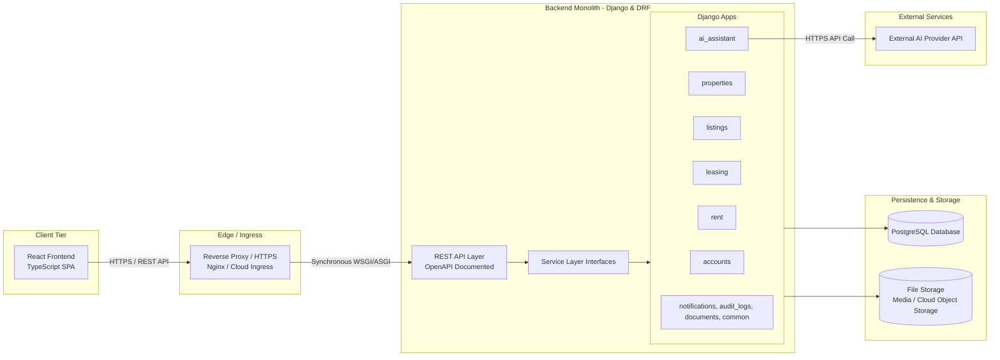

# Master System Blueprint: PropTech Platform

This document serves as the **consolidated system blueprint and final submission deliverable** for the PropTech platform. It compiles all architectural decisions, design artifacts, domain models, communication protocols, and project milestones into a unified specification.

---

## 1. Problem Statement & System Overview (Item a)

### 1.1 Problem Statement
The residential rental market suffers from fragmented workflows spanning disconnected listing portals, chat applications, and manual spreadsheets. Property owners struggle with tedious listing composition, disjointed applicant screening, and error-prone manual rent ledgers. Tenants encounter inconsistent listing details, lack of transparency in application statuses, and fragmented payment tracking.

### 1.2 System Overview
The **PropTech Platform** is a unified residential rental marketplace and property-management application. It streamlines the end-to-end rental lifecycle:
1. **Discovery & Marketplace**: Tenants search verified listings and submit structured applications.
2. **Property & Tenancy Management**: Owners manage property units, review applicants, establish tenancies, and track rent charges and payments.
3. **AI Assistant**: Accelerates listing composition by generating editable marketing drafts from verified property and unit specifications.

**Target Personas:**
- **Property Owner**: Manages real estate assets, creates listings, reviews tenant applications, issues agreements, and logs rent receipts.
- **Tenant**: Explores public listings, submits applications, views tenancy terms, and tracks rent charges and payment history.
- **Administrator**: Oversees system integrity, user moderation, and platform operations via Django Admin.

---

## 2. Product Scope & User Roles (Item a)

### 2.1 MVP Scope (P0)
- **Authentication & RBAC**: Role-based access control for Owners, Tenants, and Admins.
- **Property & Unit Management**: Multi-unit hierarchy, address details, amenities, and property images.
- **Listings & Discovery**: Listing composition, publication controls, and public search/filtering.
- **AI Listing Descriptions**: Automated draft descriptions generated via external AI provider with mandatory owner review and editing prior to publication.
- **Rental Applications**: Tenant application submissions and owner approval/rejection workflows.
- **Tenancy & Agreements**: Conversion of approved applications into active tenancies and agreement snapshots.
- **Rent & Payment Tracking**: Recurring rent charges, manual payment logging, payment allocations, and outstanding balance calculation.

### 2.2 Out-of-Scope (Deferred Post-MVP)
- Automated online payment gateway integration (Stripe/Razorpay) — *manual payment logging only in MVP*.
- Real-time in-app chat and messaging.
- Algorithmic tenant credit scoring and background verification.
- AI tenant-property matchmaking engines.
- Multi-seat organization management and distributed microservices.

*Source of truth: [Product Requirements Document (PRD)](requirements.md)*

---

## 3. UI/UX Design — Figma (Item b)

The visual design system, interaction patterns, wireframes, and responsive user flows are maintained in Figma:

- **Canonical Figma Reference**: [PropTech UI Design on Figma](https://www.figma.com/design/r4INzMqS4Z5hEmoMYkrAie/PropTech?node-id=112-5022&p=f&t=wpXOG0tOdNVMByaQ-0)
- **Design Documentation**: [`docs/design/figma.md`](design/figma.md)

### Key Mapped Screens & Flows:
1. **Authentication & Profile Setup**: Registration, credential verification, and profile management.
2. **Owner Property Dashboard**: Property and unit registration forms, amenity checklists, and photo management.
3. **Listing Studio & AI Assistant**: Listing form integrating prompt preview, AI draft generation, inline editing, and publishing controls.
4. **Tenant Marketplace**: Search bar, filter drawers (rent range, bedrooms, amenities), listing cards, and detailed property views.
5. **Application & Leasing Pipeline**: Application submission modal for tenants; review, approval, and tenancy onboarding cards for owners.
6. **Rent Ledger & History**: Rent charge schedule, payment logging modal, and tenant ledger balances.

---

## 4. System Architecture & High-Level Diagram (Item c)

The platform is engineered as a **Django modular monolith** paired with a single-page React + TypeScript frontend and a single PostgreSQL database:



### Architectural Principles:
- **Monolith Runtime**: All modules execute within a single backend application process, avoiding distributed operational overhead.
- **Strict Domain Partitioning**: Business logic is encapsulated in Django apps with explicit table ownership.
- **Synchronous In-Process Service Calls**: Modules interact via typed Python service functions (e.g. `leasing.services`) inside database transactions (`transaction.atomic()`).

*Detailed specification: [System Architecture](system-architecture.md)*

---

## 5. Service / Module Breakdown (Item d)

The backend is partitioned into nine logically separated modules:

| Module | Core Responsibility | Data Owned (Tables) | Direct Dependencies |
| :--- | :--- | :--- | :--- |
| **`accounts`** | User authentication, identity, profiles, and RBAC. | `users`, `user_profiles` | *None (Foundational)* |
| **`properties`** | Physical real estate, units, amenities, and media. | `properties`, `units`, `property_images`, `saved_properties`, `amenities`, `property_amenities`, `unit_amenities` | `accounts` |
| **`listings`** | Public rental listings, publication controls, and search. | `listings`, `listing_images` | `properties`, `accounts`, `ai_assistant` |
| **`leasing`** | Applications, status workflows, tenancies, and agreements. | `applications`, `application_status_history`, `tenancies`, `rental_agreements` | `listings`, `properties`, `accounts` |
| **`rent`** | Rent charges, manual payments, allocations, and balances. | `rent_charges`, `payments`, `payment_allocations` | `leasing`, `accounts` |
| **`ai_assistant`** | Listing description draft generation isolating external AI provider. | *Stateless (No persistent tables)* | *None (External API adapter)* |
| **`notifications`** | In-app user notifications and delivery status. | `notifications` | `accounts` |
| **`audit_logs`** | Immutable historical audit trail for critical state transitions. | `audit_logs` | `accounts` |
| **`documents`** | File metadata, attachment tracking, and access authorization. | `documents` | `accounts` |

*Detailed rules and dependency graph: [Module Boundaries](module-boundaries.md)*

---

## 6. Database Design (Item e)

The relational schema comprises **21 tables** implemented in PostgreSQL using UUID primary keys, ISO timestamps, INR currency decimals, and strict referential integrity constraints:

```text
├── Accounts (2 tables)
│   ├── users
│   └── user_profiles
├── Properties & Amenities (7 tables)
│   ├── properties
│   ├── units
│   ├── property_images
│   ├── saved_properties
│   ├── amenities
│   ├── property_amenities
│   └── unit_amenities
├── Listings (2 tables)
│   ├── listings
│   └── listing_images
├── Leasing (4 tables)
│   ├── applications
│   ├── application_status_history
│   ├── tenancies
│   └── rental_agreements
├── Rent & Ledger (3 tables)
│   ├── rent_charges
│   ├── payments
│   └── payment_allocations
└── Supporting Services (3 tables)
    ├── notifications
    ├── audit_logs
    └── documents
```

### Key Artifacts:
- **Design Overview**: [`docs/database-design.md`](database-design.md)
- **Editable DBML Schema**: [`docs/diagrams/database-erd.dbml`](diagrams/database-erd.dbml)
- **Visual ERD Diagram**: [`docs/diagrams/database-erd.png`](diagrams/database-erd.png)

---

## 7. API Design & Documentation (Item f)

The platform exposes a synchronous RESTful API built with Django REST Framework adhering to standard JSON conventions:

- **API Documentation**: [`docs/api/README.md`](api/README.md)
- **Canonical Postman Collection**: [`docs/api/postman/PropTech_API_v1.postman_collection.json`](api/postman/PropTech_API_v1.postman_collection.json)

### Contract Conventions:
- **Provisional Base URL**: `http://127.0.0.1:8000/api/v1`
- **Authentication**: JWT Bearer token passed via HTTP header:
  ```http
  Authorization: Bearer {{access_token}}
  ```
- **Payload Format**: `application/json` with `snake_case` keys and UUID resource identifiers.
- **Media Uploads**: `multipart/form-data` for property/unit images and uploaded tenancy documents.
- **Maturity Distinction**: The Postman collection contains 133 mock examples providing the target contract for frontend integration; backend routes will become operational as Django viewsets and serializers are implemented.

---

## 8. Communication & Infrastructure Design (Item g)

### 8.1 Tier Communication
1. **Frontend-to-Backend**: The React SPA communicates with Django REST Framework over HTTPS using standard REST endpoints.
2. **Inter-Module Communication**: Domain modules interact via Python service-layer calls within the same process. Direct cross-module SQL mutations are prohibited.
3. **External AI Communication**: The `ai_assistant` module interacts with the external AI provider over outbound HTTPS with strict timeouts and error fallbacks.

### 8.2 Conceptual Domain Events (MVP vs. Future)
To maintain architectural seams without introducing distributed queue overhead, the MVP models business events as synchronous service calls executed inside database transactions (`transaction.atomic()`):

| Conceptual Event | Triggering Module | Synchronous MVP Action | Future Consumer (Post-MVP) |
| :--- | :--- | :--- | :--- |
| `ListingPublished` | `listings` | Status set to published; visible in public search. | Search indexer, marketing emails. |
| `ApplicationSubmitted` | `leasing` | Application record created; owner notification generated. | SMS / Push notifications. |
| `ApplicationApproved` | `leasing` | Application approved; tenancy drafted; applicant notified. | Digital lease signing dispatch. |
| `TenancyCreated` | `leasing` | Tenancy activated; unit status set to occupied; initial rent charge created. | Welcome email, calendar alerts. |
| `PaymentRecorded` | `rent` | Manual payment recorded; allocated to charges; balance recalculated. | Tenant receipt email, ledger export. |

*Detailed infrastructure baseline: [System Architecture](system-architecture.md)*

---

## 9. AI Integration Plan (Item h)

The platform's initial AI capability is focused on **automated rental listing description draft generation**:

- **Input**: Verified property and unit facts (bedrooms, bathrooms, area, amenities, location).
- **Processing**: The `ai_assistant` formats a structured prompt, applies safety filters, and queries the external provider over HTTPS.
- **Output**: An editable marketing description draft returned to the owner's browser.
- **Human-in-the-Loop Safeguard**: The AI service cannot persist or publish listings directly; all drafts must be explicitly reviewed, edited, and approved by the property owner.
- **Fault Tolerance**: If the AI provider is unavailable or times out, the UI gracefully informs the owner and provides a manual copy editor without blocking listing creation.

*Detailed prompt templates, validation rules, and error handling: [AI Integration Plan](ai-integration.md)*

---

## 10. End-to-End User Journey

The unified system supports the complete end-to-end user lifecycle:
1. **Registration**: An owner registers and authenticates via `/auth/register/` and `/auth/login/`.
2. **Asset Setup**: The owner creates a property and rentable units with catalogued amenities.
3. **Listing Composition**: The owner drafts a listing, invokes the AI assistant for description copy, edits the text, and publishes the listing.
4. **Discovery & Application**: A prospective tenant searches public listings, reviews unit attributes, and submits a rental application.
5. **Review & Approval**: The owner reviews the application and approves it.
6. **Tenancy Onboarding**: The approved application is converted into an active tenancy with an associated rental agreement.
7. **Ledger & Settlement**: Monthly rent charges are generated; the owner records manual tenant payments; payment allocations settle outstanding charges and update tenant balances.

---

## 11. Milestone Completion Matrix

All mandatory milestones from project planning (`SecondProject - Flow`) are completed and integrated into version control:

| Milestone / Requirement | Deliverable Path | Status |
| :--- | :--- | :--- |
| **1. Product Scope & Modules** | [`docs/requirements.md`](requirements.md) | **Complete** |
| **2. UI/UX Design (Figma)** | [`docs/design/figma.md`](design/figma.md) | **Complete** |
| **3. High-Level Architecture** | [`docs/system-architecture.md`](system-architecture.md) | **Complete** |
| **4. Service Breakdown** | [`docs/module-boundaries.md`](module-boundaries.md) | **Complete** |
| **5. Database Design & ERD** | [`docs/database-design.md`](database-design.md) & [`docs/diagrams/`](diagrams/) | **Complete** |
| **6. API Design & Postman** | [`docs/api/README.md`](api/README.md) & [`docs/api/postman/`](api/postman/) | **Complete** |
| **7. Communication Design** | [`docs/system-architecture.md`](system-architecture.md) & Section 8 above | **Complete** |
| **8. AI Integration Plan** | [`docs/ai-integration.md`](ai-integration.md) | **Complete** |
| **9. Final System Blueprint** | [`docs/final-system-blueprint.md`](final-system-blueprint.md) | **Complete** |
