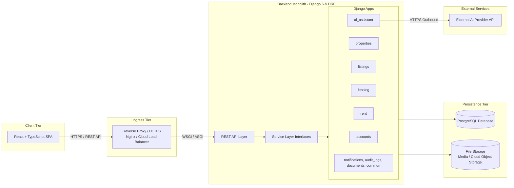
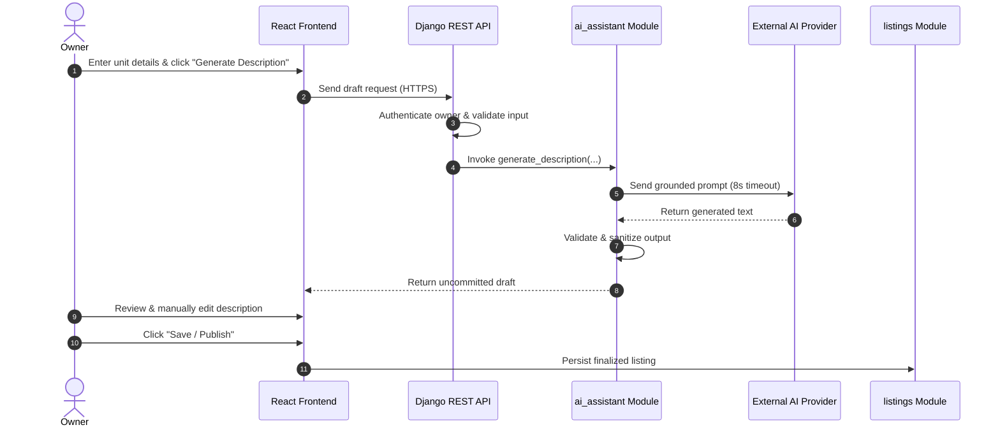

# Master System Blueprint: PropTech Platform

## 1. Project Overview

### 1.1 Platform Name & Purpose
The **PropTech Platform** is a residential rental solution that unifies property discovery and ongoing tenancy management into a single system. It bridges the gap between prospective tenants searching for housing and property owners managing units, leases, and rent collection.

### 1.2 Problem Statement
Residential rental management is fragmented across disparate channels:
- Property owners advertise listings on public classifieds, track applicants over email or messaging apps, and record rent payments and leases in manual spreadsheets.
- Drafting attractive, informative property listings is time-consuming and inconsistent.
- Prospective tenants face disjointed application experiences without visibility into their application status or historical payment records.

### 1.3 Intended Users & Core Needs
- **Property Owners (Landlords / Managers)**: Need an integrated tool to manage units, generate listing copy, screen applicants, execute tenancies, and track rent charges and payments.
- **Tenants (Applicants / Residents)**: Need to search available listings, submit digital rental applications, track application status, and view tenancy agreements and rent payment histories.
- **Administrators**: Require operational oversight and system governance through a secure admin portal.

### 1.4 Proposed Solution
A unified, web-based platform built as a modular monolith. It provides a public rental marketplace, owner property management tools, and an AI-assisted listing copy generator that keeps the owner in full editorial control.

*Reference: [requirements.md](requirements.md)*

---

## 2. Product Scope and Features

### 2.1 Confirmed MVP Scope
The 3-week MVP encompasses seven essential capabilities:
1. **User Authentication & Authorization**: Role-based access control (RBAC) separating Owner, Tenant, and Admin roles.
2. **Property & Unit Management**: CRUD operations for multi-unit residential properties and physical unit details.
3. **Listing Management & Discovery**: Unit listing creation, publication status lifecycle, and public search/filtering.
4. **AI-Generated Listing Descriptions**: Automated draft descriptions from unit specifications, fully editable before publishing.
5. **Rental Applications**: Tenant application submissions and owner review workflows (approve/reject).
6. **Tenancy Management**: Creation of tenancy records from approved applications with agreed rent and dates.
7. **Rent & Payment Tracking**: Issuance of rent charges and logging of manual payments with balance calculations.

### 2.2 User Roles & Responsibilities

| Role | Key Capabilities |
| :--- | :--- |
| **Owner** | Manages properties and units; drafts and publishes listings; generates AI descriptions; approves/rejects applications; establishes tenancies; records manual rent payments. |
| **Tenant** | Searches listings; submits applications; tracks application statuses; views tenancy terms, rent charges, and payment records. |
| **Admin** | Oversees platform users, listings, and data integrity via Django Admin. |

### 2.3 Explicitly Out of Scope for MVP
- Online payment gateway integration (payments are recorded manually)
- Automated tenant screening, identity verification, and background/credit checks
- In-app messaging, real-time chat, and maintenance ticketing
- Advanced AI matching and recommendation algorithms
- Multi-seat organization hierarchies and team permissions

*Reference: [requirements.md](requirements.md)*

---

## 3. UI/UX Design

### 3.1 Status: Pending
- **Current State**: The frontend design requirements specify a responsive Single Page Application (SPA) built with React and TypeScript, providing dedicated portals for Owners and Tenants.
- **Outstanding Deliverables**: Detailed wireframes, visual mockups, design component systems, and Figma design files have not yet been produced for the repository.
- **Pending Deliverable**: Requirement 2 (UI/UX Design) remains pending.

---

## 4. High-Level Architecture

The system is architected as a **modular monolith**, selected specifically to maximize delivery velocity, minimize operational complexity, and ensure transactional data integrity for a 3-week MVP timeline.



### Architectural Decisions:
- **Modular Monolith**: All backend domains run in a single Django application process, eliminating distributed network overhead, RPC complexity, and microservice deployment pipelines.
- **Frontend**: Client-side React + TypeScript SPA communicating over HTTPS.
- **Backend**: Django 6 with Django REST Framework (DRF) handling business logic, validation, and REST APIs.
- **Database**: Single PostgreSQL database instance providing ACID guarantees for financial and tenancy records.
- **File Storage**: Local filesystem media storage in development; private cloud object storage (e.g., S3/GCS) in production.
- **External AI Provider**: Third-party LLM API consumed exclusively through the backend `ai_assistant` module adapter.

*Reference: [system-architecture.md](system-architecture.md)*

---

## 5. Modules and Responsibilities

The backend is decomposed into nine logically separated modules (Django apps) under `backend/apps/`:

| Module | Core Responsibility | Data Owned (Tables) | Must Not Handle | Upstream Dependencies |
| :--- | :--- | :--- | :--- | :--- |
| **`accounts`** | User authentication, identity, and RBAC via Django groups. | `users`, `user_profiles` | Property, lease, or financial data. | *None (Foundational)* |
| **`properties`** | Properties, units, physical addresses, and ownership links. | `properties`, `units`, `property_images`, `saved_properties` | Listings, pricing, or tenant applications. | `accounts` |
| **`listings`** | Public listings, pricing, availability, and search discovery. | `listings`, `listing_images` | Physical unit attributes or lease creation. | `properties`, `accounts`, `ai_assistant` |
| **`leasing`** | Rental applications, status reviews, and tenancy contracts. | `applications`, `application_status_history`, `tenancies` | Rent charge issuance or payment recording. | `listings`, `properties`, `accounts` |
| **`rent`** | Rent charges, manual payments, allocations, and balances. | `rent_charges`, `payments`, `payment_allocations` | Lease terms or payment gateway execution. | `leasing`, `accounts` |
| **`ai_assistant`** | Prompt construction and external AI provider communication. | *Stateless (Zero persistent tables)* | Listing persistence or publication approval. | *None (External API adapter)* |
| **`notifications`** | In-app user notifications and read/unread status. | `notifications` | Business rules or external SMS/push gateways. | `accounts` |
| **`audit_logs`** | Immutable historical audit logs for critical state changes. | `audit_logs` | General application logs or business logic. | `accounts` |
| **`documents`** | Centralized file attachment metadata management. | `documents` | Binary file hosting. | `accounts` |

### Internal Communication Rules:
- Modules communicate exclusively through **Python service-layer functions** (e.g., `leasing.services.create_tenancy_from_application(...)`).
- Direct cross-module database writes are prohibited. Each module strictly owns its respective tables.
- Multi-step cross-module operations execute within database transactions (`transaction.atomic()`).

*Reference: [module-boundaries.md](module-boundaries.md)*

---

## 6. Database Design

### 6.1 Data Model Overview
The system relies on a 17-table relational schema modeled in PostgreSQL using UUID primary keys, structured foreign keys, and indexes tailored for tenancy and financial integrity.

```
users (1) ──< user_profiles (1)
users (1) ──< properties (N) ──< units (N) ──< listings (N)
units (1) ──< tenancies (N) ──< rent_charges (N) ──< payment_allocations (N)
tenancies (1) ──< payments (N) ──< payment_allocations (N)
listings (1) ──< applications (N) ──< application_status_history (N)
applications (1) ──< tenancies (1)
```

### 6.2 Existing Deliverables & Status
- **Detailed Documentation**: Full schema catalogue and constraint analysis at [database-design.md](database-design.md).
- **ERD Diagram**: Available as an exported visual artifact at [diagrams/database-erd.png](diagrams/database-erd.png).
- **Editable Source File**: Available at [diagrams/database-erd.dbml](diagrams/database-erd.dbml).
- **Status**: **Completed** (Schema, ERD image, and DBML source committed).

### 6.3 Pending Schema Validations & Fixes
An independent architectural review identified the following adjustments that must be finalized prior to running migrations:
1. **User Model**: Add `last_login timestamptz` to `users` to satisfy Django `AbstractBaseUser`.
2. **Cross-Tenancy Payment Leakage**: Add `tenancy_id` to `payment_allocations` with composite foreign keys to prevent allocating payments to charges of a different tenancy.
3. **Billing Model Flexibility**: Add `charge_type` to `rent_charges` to allow billing utility fees or late fees alongside monthly rent.
4. **Integrity Constraints**: Add partial unique indexes for single active listings per unit and single primary images per property/listing.

---

## 7. API Design

### 7.1 Status: Pending
- **Design Intent**: The platform will expose a stateless REST API using Django REST Framework, documented with an OpenAPI (Swagger) specification.
- **Current State**: Endpoints, HTTP methods, URL paths, and JSON request/response schemas have not yet been formalized in documentation.
- **Pending Deliverable**: Requirement 6 (API Design) remains pending.

---

## 8. Communication and Infrastructure

### 8.1 Summary of Communication Channels
- **Client-to-Backend**: React SPA communicates with Django REST Framework via REST APIs over secure HTTPS with JSON payloads.
- **Internal Modules**: In-process synchronous Python service-layer calls wrapped in `transaction.atomic()`.
- **Persistence**: Relational ACID storage in PostgreSQL; media and documents stored in file storage.
- **External AI**: Outbound HTTPS requests to an external language model API handled strictly within `ai_assistant`.

### 8.2 Event Strategy (MVP vs. Future)
- **MVP**: Five conceptual domain events (`ListingPublished`, `ApplicationSubmitted`, `ApplicationApproved`, `TenancyCreated`, `PaymentRecorded`) are executed **synchronously via direct service calls**.
- **No Message Brokers**: Distributed brokers (Kafka, RabbitMQ, Celery, Redis) are deliberately omitted for the MVP to maintain simplicity.
- **Future Seams**: These conceptual events serve as architectural extension points for introducing background task workers post-launch.

### 8.3 Infrastructure Baseline
- React SPA static bundle on CDN/web server.
- Monolithic Django backend container/process.
- Managed PostgreSQL database instance.
- Reverse proxy (Nginx) for TLS termination and static routing.
- Local media storage in dev; private cloud bucket (S3/GCS) in prod.

*Reference: [system-architecture.md](system-architecture.md)*

---

## 9. AI Integration

The platform includes a dedicated, human-in-the-loop AI integration for generating property listing copy.



### Core AI Principles:
- **Factual Grounding**: Prompts forbid hallucinations regarding landmarks, travel times, or unlisted amenities.
- **Editorial Control**: Output is delivered as an editable draft. The AI cannot save or publish listings directly.
- **Error Handling & Resilience**: 8-second timeout on provider calls; 429 rate limits and 5xx errors return a clean fallback allowing the owner to write copy manually without workflow disruption.
- **Privacy & Cost Controls**: Prompts contain only physical unit specs (no user personal data or credentials); server-side rate limits cap token costs.

*Reference: [ai-integration.md](ai-integration.md)*

---

## 10. Key End-to-End Workflows

The complete lifecycle of a property rental flows through six key phases:

1. **Property & Unit Setup**: Owner logs in and creates a Property record (address, location), then defines one or more Units (bedrooms, bathrooms, rent, furnishing).
2. **Listing Creation & AI Copy**: Owner creates a listing for an available unit. The owner requests an AI description draft, reviews/edits the generated copy, and saves the listing as a draft or published.
3. **Marketplace Discovery & Application**: A tenant searches published listings, views details, and submits a digital application.
4. **Application Review**: The owner reviews the application and marks it as approved or rejected.
5. **Tenancy Creation**: Upon approval, a Tenancy record is created with agreed rent and lease dates. The unit status transitions to occupied.
6. **Rent & Payment Ledger**: The owner issues a rent charge for the billing period. When the tenant pays, the owner records a manual payment, allocating it against the charge and updating the ledger balance.

> *Note: This workflow represents the documented system design. Application code implementing these steps has not yet been written.*

---

## 11. Security and Reliability

- **Authentication & Authorization**: Centralized session/token authentication in `accounts`. Role-based authorization (Owner, Tenant, Admin) enforced on every endpoint.
- **Resource Ownership Verification**: Queries enforce that owners can only modify their own properties, listings, and leases.
- **Input Validation**: Strict DRF serializer validation sanitizes all payloads before reaching domain services.
- **Credential Protection**: Database passwords, Django secret keys, and AI provider API keys reside strictly in server environment variables.
- **Document Access Security**: Uploaded files and tenant documents are private; file retrieval routes verify authorization before serving data.
- **Data Integrity via Transactions**: Multi-step operations (e.g., approving an application and drafting a lease, or allocating a payment) execute inside `transaction.atomic()`.
- **Fault-Tolerant AI**: External AI failure never blocks listing management; owners can always input copy manually.

---

## 12. MVP Scope and Future Enhancements

### 12.1 MVP Boundary
The MVP delivers a complete, operable rental platform combining core marketplace discovery and essential property management without distributed infrastructure.

### 12.2 Future Roadmap
- **Automated Digital Payments**: Direct integration with payment gateways (Stripe, Razorpay) for automated rent collection.
- **Tenant Screening & Identity**: Digital KYC, credit check, and background verification integrations.
- **In-App Messaging**: Real-time owner-tenant communication and maintenance request ticketing.
- **Advanced AI Matching**: Algorithmic tenant-to-property recommendation engines.
- **Multi-User Property Management**: Multi-seat organization management with delegated staff permissions.
- **Native Mobile Apps**: Dedicated iOS and Android applications.

---

## 13. Requirements Completion Checklist

This table reflects the actual status of the nine project requirements based on the current repository artifacts:

| # | Requirement | Status | Relevant Deliverable / Document | Outstanding Work |
| :-: | :--- | :---: | :--- | :--- |
| **1** | **Product Scope & Modules** | **Completed** | [requirements.md](requirements.md) | None. Scope, roles, and MVP features are documented. |
| **2** | **UI/UX Design** | **Pending** | *None* | Wireframes, user flow diagrams, and Figma designs need to be created. |
| **3** | **High-Level Architecture** | **Completed** | [system-architecture.md](system-architecture.md) | None. Modular monolith architecture and component tiers are documented. |
| **4** | **Service/System Breakdown** | **Completed** | [module-boundaries.md](module-boundaries.md) | None. 9 modules, boundaries, ownership, and dependencies are documented. |
| **5** | **Database Design** | **Completed** | [database-design.md](database-design.md),<br>[diagrams/database-erd.png](diagrams/database-erd.png),<br>[diagrams/database-erd.dbml](diagrams/database-erd.dbml) | Schema catalogue, visual ERD, and DBML source documented. |
| **6** | **API Design** | **Pending** | *None* | Define REST endpoints, request/response JSON schemas, and OpenAPI specification. |
| **7** | **Communication & Infrastructure** | **Completed** | [system-architecture.md](system-architecture.md) | None. Internal service calls, external AI, and infrastructure documented. |
| **8** | **AI Integration Planning** | **Completed** | [ai-integration.md](ai-integration.md) | None. Scope, prompt engineering, validation, error fallback, and controls documented. |
| **9** | **Final System Blueprint** | **Partially Completed** | [final-system-blueprint.md](final-system-blueprint.md) | Consolidated master document created; pending final updates once Req 2, 5, and 6 are completed. |
