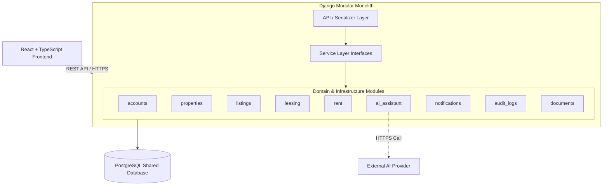
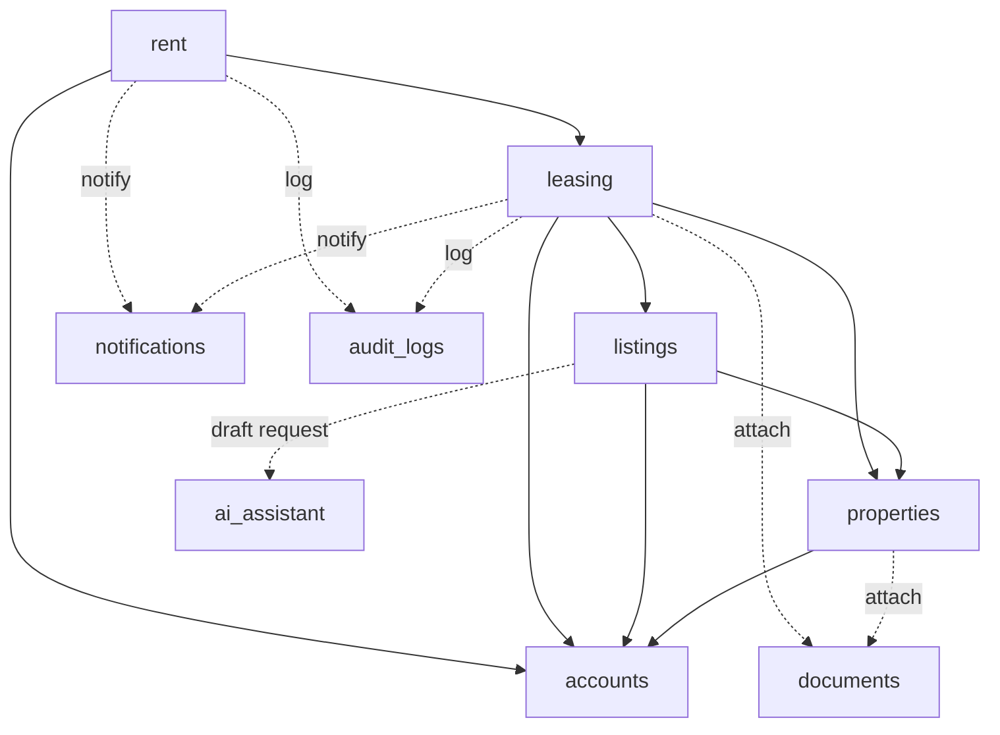

# Architecture: System Breakdown & Module Boundaries

## 1. Overview & Architecture

The PropTech platform is designed as a **Django modular monolith** backed by a single PostgreSQL database and paired with a React + TypeScript frontend communicating over REST APIs.

Rather than using distributed microservices, all backend capabilities reside in a single deployable application organized into logically separated modules (Django apps). Each module owns a dedicated slice of domain data and logic.



### Key Communication Decisions
- **Monolith Runtime**: All modules execute within a single backend application process.
- **REST API Boundary**: The frontend communicates exclusively with backend API endpoints.
- **Service Interfaces**: Inter-module communication occurs via defined Python service-layer functions (e.g., `leasing.services`) rather than cross-module direct database mutations.
- **Shared Database with Strict Ownership**: PostgreSQL is the single database, but each table is strictly owned by one module. Modules must never write directly to tables owned by another module.

---

## 2. Module Responsibilities and Boundaries

The system is partitioned into nine distinct modules:

| Module | Core Responsibility | Data Owned (Tables) | Must Not Handle | Depends On |
| :--- | :--- | :--- | :--- | :--- |
| **`accounts`** | User authentication, identity, profiles, and role-based access control (RBAC). | `users`, `user_profiles` | Property, lease, or financial operations. | *None (Foundational)* |
| **`properties`** | Physical property details, unit configurations, and owner associations. | `properties`, `units`, `property_images`, `saved_properties`, `amenities`, `property_amenities`, `unit_amenities` | Rental listings, pricing terms, tenant applications. | `accounts` |
| **`listings`** | Public marketing listings, rental terms, availability, and marketplace search. | `listings`, `listing_images` | Physical unit specs (owned by `properties`) or lease execution. | `properties`, `accounts`, `ai_assistant` |
| **`leasing`** | Rental application workflow, applicant reviews, tenancy agreements, and lease terms. | `applications`, `application_status_history`, `tenancies`, `rental_agreements` | Rent charge calculation or manual payment collection. | `listings`, `properties`, `accounts` |
| **`rent`** | Rent charge generation, manual payment logging, payment allocations, and balances. | `rent_charges`, `payments`, `payment_allocations` | Lease contract lifecycle or external payment gateways. | `leasing`, `accounts` |
| **`ai_assistant`** | Listing description draft generation isolating external AI provider integration. | *Stateless (No persistent tables)* | Listing persistence or publication approval. | *None (External API adapter)* |
| **`notifications`** | In-app user notifications, delivery records, and read/unread status tracking. | `notifications` | Business logic triggers or external SMS/Push gateways. | `accounts` |
| **`audit_logs`** | Immutable historical audit trail for critical state mutations and security events. | `audit_logs` | General operational logging or domain transactions. | `accounts` |
| **`documents`** | Centralized metadata tracking for files and attachments across entities. | `documents` | Binary file storage (handled by cloud storage/filesystem). | `accounts` |

---

## 3. Module Dependencies

Cross-module interactions follow strict unidirectional rules to prevent circular dependencies.



### Dependency Rules:
1. `accounts` is the foundational dependency providing user identities and authorization.
2. `properties` manages physical real estate and has no knowledge of downstream transactions.
3. `listings` links to units in `properties` and requests draft copy from `ai_assistant`.
4. `leasing` coordinates applications for `listings` and converts approved applicants into `tenancies`.
5. `rent` manages the financial ledger for active `tenancies` created by `leasing`.
6. `notifications`, `audit_logs`, and `documents` provide cross-cutting services consumed by domain modules via standard service calls.

---

## 4. Event Strategy (MVP vs. Future)

### MVP Strategy: Synchronous Direct Service Calls
For the 3-week MVP, **asynchronous event brokers (such as Kafka, RabbitMQ, Celery, or Redis) are intentionally omitted**. 
- Adding message brokers introduces unnecessary operational complexity, infrastructure overhead, and eventual consistency challenges.
- All MVP business operations execute synchronously within standard Django database transactions (`transaction.atomic()`).

### Conceptual Domain Events
To ensure clean architectural seams for future expansion, the core business workflows are modeled around five conceptual domain events:

| Conceptual Event | Triggering Module | Synchronous Action in MVP | Future Async Consumer |
| :--- | :--- | :--- | :--- |
| **`ListingPublished`** | `listings` | Listing status set to published; visible in public search. | Search indexer, marketing emails. |
| **`ApplicationSubmitted`**| `leasing` | Application record created; notification created for property owner. | Owner email / SMS alert. |
| **`ApplicationApproved`** | `leasing` | Application status updated; applicant notified; tenancy drafted. | Digital lease signing dispatch. |
| **`TenancyCreated`** | `leasing` | Tenancy activated; unit status set to occupied; initial rent charge created. | Tenant welcome email, calendar alerts. |
| **`PaymentRecorded`** | `rent` | Manual payment logged; payment allocated to charges; balance recalculated. | Tenant receipt email, accounting export. |

> **Implementation Note**: In the current MVP, these events represent logical boundaries handled via direct service invocations. If background task processing is introduced post-launch, these service calls can be transitioned to asynchronous event handlers without modifying core business rules.

---

## 5. Backend Directory Structure

The proposed structure organizes modules into distinct Django applications under `backend/apps/`:

```text
backend/
├── apps/
│   ├── accounts/         # Identity, users, profiles, role authorization
│   ├── properties/       # Properties, units, property images, saved properties
│   ├── listings/         # Public listings, listing images, search
│   ├── leasing/          # Applications, status history, tenancies
│   ├── rent/             # Rent charges, payments, payment allocations
│   ├── ai_assistant/     # AI listing description generator & provider adapter
│   ├── notifications/    # In-app notifications
│   ├── audit_logs/       # System audit logging
│   ├── documents/        # File and attachment metadata
│   └── common/           # Shared base models, mixins, technical utilities
├── config/               # Django project settings and root URLs
├── manage.py
└── requirements.txt
```
