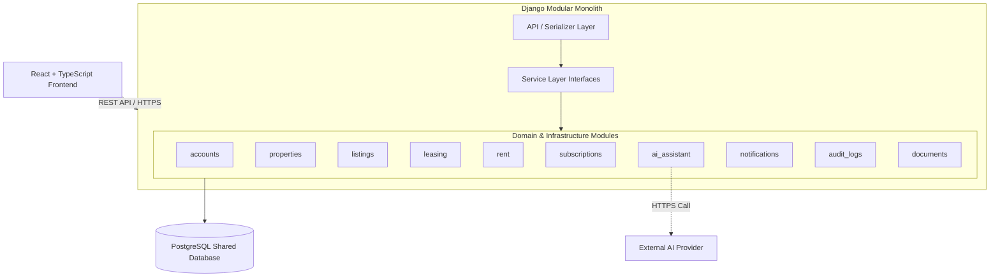
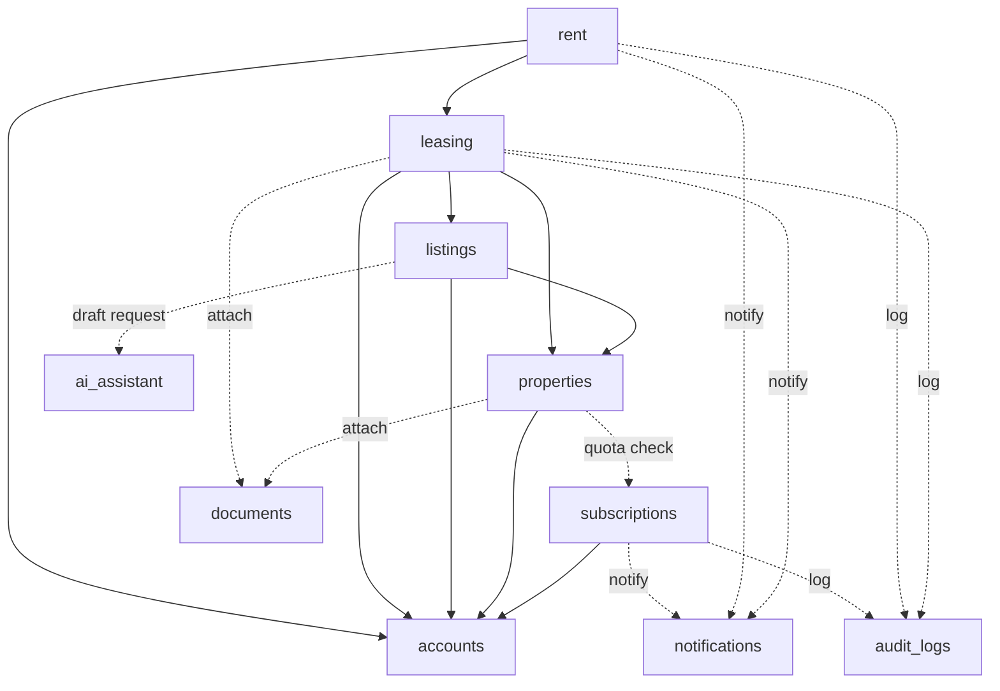

# Architecture: System Breakdown & Module Boundaries

## 1. Overview & Architecture

The PropTech platform is designed as a **Django modular monolith** backed by a single PostgreSQL database and paired with a React + TypeScript frontend communicating over REST APIs.

Rather than using distributed microservices, all backend capabilities reside in a single deployable application organized into logically separated modules (Django apps). Each module owns a dedicated slice of domain data and logic.



### Key Communication Decisions
- **Monolith Runtime**: All modules execute within a single backend application process.
- **REST API Boundary**: The frontend communicates exclusively with backend API endpoints.
- **Service Interfaces**: Inter-module communication occurs via defined Python service-layer functions (e.g., `leasing.services`, `subscriptions.services`) rather than cross-module direct database mutations.
- **Shared Database with Strict Ownership**: PostgreSQL is the single database, but each table is strictly owned by one module. Modules must never write directly to tables owned by another module.

---

## 2. Module Responsibilities and Boundaries

The system is partitioned into ten distinct modules:

| Module | Core Responsibility | Data Owned (Tables) | Must Not Handle | Depends On |
| :--- | :--- | :--- | :--- | :--- |
| **`accounts`** | User authentication, identity, credentials, profiles, social accounts (OAuth 2.0), and role-based access control (RBAC). | `users`, `user_profiles`, `social_accounts` | Property, lease, subscription, or financial operations. | *None (Foundational)* |
| **`properties`** | Physical real estate asset management (residential & commercial categories/types), physical specs, photos, and amenities catalogue. | `properties`, `property_images`, `amenities`, `property_amenities` | Marketing terms, rental pricing, tenant applications, or lease agreements. | `accounts`, `subscriptions` (for quota checks) |
| **`listings`** | Public marketing listings, asking terms (rent, deposit, available_from), moderation workflows, and saved properties. | `listings`, `saved_properties` | Physical property specifications (owned by `properties`) or executed lease terms. | `properties`, `accounts`, `ai_assistant` |
| **`leasing`** | Rental application pipeline, applicant reviews, tenancy agreements, and move-in/out tracking. | `applications`, `application_status_history`, `tenancies` | Rent charge generation, manual payment collection, or binary document storage. *(Tenancy rental agreements are tracked in `documents`).* | `listings`, `properties`, `accounts` |
| **`rent`** | Rent charge generation, manual payment logging, refund tracking, payment allocations, and ledger balances. | `rent_charges`, `payments`, `payment_refunds`, `payment_allocations` | Lease contract lifecycle, digital signature collection, or automated payment gateways. | `leasing`, `accounts` |
| **`subscriptions`** | Owner SaaS subscription tiers, property quotas, active subscriptions, and subscription billing history. | `subscription_plans`, `subscriptions`, `subscription_payments` | Tenancy rent collection, tenant payments, or property listing operations. | `accounts` |
| **`ai_assistant`** | Listing description draft generation isolating external AI provider integration. | *Stateless (No persistent tables)* | Listing persistence or publication approval. | *None (External API adapter)* |
| **`notifications`** | In-app user notifications, polymorphic alerts, and delivery/read tracking. | `notifications` | Business logic triggers or external SMS/Push gateways. | `accounts` |
| **`audit_logs`** | Immutable historical audit trail for critical state mutations and security events. | `audit_logs` | General operational application logging or domain transactions. | `accounts` |
| **`documents`** | Centralized metadata tracking for files and attachments across properties, applications, and tenancies (including tenancy rental agreements). | `documents` | Binary file storage (handled by cloud storage/filesystem). | `accounts` |

---

## 3. Module Dependencies

Cross-module interactions follow strict unidirectional rules to prevent circular dependencies.



### Dependency Rules:
1. `accounts` is the foundational dependency providing user identities and authorization.
2. `subscriptions` manages owner subscription tiers and property quotas. Property creation in `properties` enforces quota via a transactional workflow: lock the owner's row (or active subscription row), count all properties belonging to the owner, validate the count against the applicable plan quota, and create the property within the same transaction.
3. `properties` manages physical real estate assets (residential and commercial) where one property is one independently rentable asset.
4. `listings` links directly to `properties` for marketing terms and requests draft copy from `ai_assistant`.
5. `leasing` coordinates applications for `listings` and converts approved applicants into `tenancies` for the property.
6. `rent` manages the financial ledger (charges, payments, refunds, allocations) for active `tenancies` created by `leasing`.
7. `notifications`, `audit_logs`, and `documents` provide cross-cutting services consumed by domain modules via standard service calls. Tenancy rental agreements are tracked directly in `documents` attached to `tenancy_id`.

---

## 4. Event Strategy (MVP vs. Future)

### MVP Strategy: Synchronous Direct Service Calls
For the 3-week MVP, **asynchronous event brokers (such as Kafka, RabbitMQ, Celery, or Redis) are intentionally omitted**. 
- Adding message brokers introduces unnecessary operational complexity, infrastructure overhead, and eventual consistency challenges.
- All MVP business operations execute synchronously within standard Django database transactions (`transaction.atomic()`).

### Conceptual Domain Events
To ensure clean architectural seams for future expansion, the core business workflows are modeled around conceptual domain events:

| Conceptual Event | Triggering Module | Synchronous Action in MVP | Future Async Consumer |
| :--- | :--- | :--- | :--- |
| **`ListingPublished`** | `listings` | Listing status set to published; visible in public search. | Search indexer, marketing emails. |
| **`ApplicationSubmitted`**| `leasing` | Application record created; notification created for property owner. | Owner email / SMS alert. |
| **`ApplicationApproved`** | `leasing` | Application status updated; applicant notified; tenancy drafted. | Digital lease signing dispatch. |
| **`TenancyCreated`** | `leasing` | Tenancy activated; property status set to occupied; initial rent charge created. | Tenant welcome email, calendar alerts. |
| **`PaymentRecorded`** | `rent` | Manual payment logged; payment allocated to charges; balance recalculated. | Tenant receipt email, accounting export. |
| **`SubscriptionActivated`** | `subscriptions` | Owner subscription activated; owner property quota updated. | Welcome email, invoice dispatch. |

> **Implementation Note**: In the current MVP, these events represent logical boundaries handled via direct service invocations. If background task processing is introduced post-launch, these service calls can be transitioned to asynchronous event handlers without modifying core business rules.

---

## 5. Backend Directory Structure

The proposed structure organizes modules into distinct Django applications under `backend/apps/`:

```text
backend/
├── apps/
│   ├── accounts/         # Identity, users, profiles, social accounts, role authorization
│   ├── properties/       # Property assets, property images, amenities catalogue
│   ├── listings/         # Public listings, saved properties, search
│   ├── leasing/          # Applications, status history, tenancies
│   ├── rent/             # Rent charges, payments, refunds, payment allocations
│   ├── subscriptions/    # Subscription plans, owner subscriptions, subscription payments, property quotas
│   ├── ai_assistant/     # AI listing description generator & provider adapter
│   ├── notifications/    # In-app notifications
│   ├── audit_logs/       # System audit logging
│   ├── documents/        # File and attachment metadata (including tenancy rental agreements)
│   └── common/           # Shared base models, mixins, technical utilities
├── config/               # Django project settings and root URLs
├── manage.py
└── requirements.txt
```

