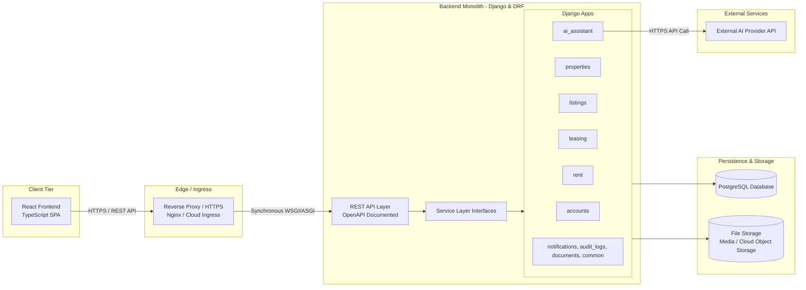

# Architecture: System Architecture

## 1. Overview
The PropTech platform is structured as a **modular monolith** pairing a single-page React + TypeScript frontend with a Django REST Framework backend and a single PostgreSQL database. Domain logic is cleanly partitioned into internal Django modules, and external AI capability is encapsulated within a dedicated adapter module. Communication occurs synchronously over a REST API documented via OpenAPI.

---

## 2. System Architecture Diagram

---

## 3. Communication & Infrastructure

### 3.1 Frontend-to-Backend Communication
- The React single-page application communicates with Django REST Framework via REST APIs over secure HTTPS.
- All client interactions follow a synchronous JSON request/response model.
- Authentication tokens/session credentials are passed in standard HTTP headers on every request.
- *Detailed API endpoints, URL paths, and request/response schemas are specified separately under Requirement 6.*

### 3.2 Internal Module Communication
- Backend modules communicate in-process using explicit **service-layer interfaces and direct Python function calls**.
- Modules strictly adhere to the domain responsibilities and table ownership rules defined in [`docs/module-boundaries.md`](file:///home/shifil/Desktop/Brototype/Paper%207/proptech-platform/docs/module-boundaries.md).
- Cross-boundary mutations must go through service functions rather than direct foreign model writes.
- Workflows spanning multiple related database changes execute inside **database transactions (`transaction.atomic()`)** to maintain strict ACID consistency.

### 3.3 External AI Communication
- The `ai_assistant` module communicates with an external AI provider API over HTTPS.
- Provider-specific configuration, prompt templates, and HTTP transport logic remain fully isolated inside the `ai_assistant` module.
- Input data (unit and property specs) is validated prior to external dispatch.
- External API calls enforce timeouts and graceful error handling; if the AI service fails or times out, the system returns a safe fallback so property and listing operations are never blocked.
- *Detailed prompt templates, validation rules, and error handling are documented in [`docs/ai-integration.md`](file:///home/shifil/Desktop/Brototype/Paper%207/proptech-platform/docs/ai-integration.md).*

### 3.4 Events and Asynchronous Processing
- Core business milestones are conceptualized as domain events:
  - `ListingPublished`: Triggers listing visibility.
  - `ApplicationSubmitted`: Notifies property owner.
  - `ApplicationApproved`: Initiates tenancy drafting.
  - `TenancyCreated`: Marks unit occupied and issues initial rent charge.
  - `PaymentRecorded`: Allocates payment and recalculates balance.
- **MVP Strategy**: These are **conceptual business events** executed synchronously via service-layer calls inside database transactions.
- **No Broker Infrastructure**: Distributed message brokers (e.g., Kafka, RabbitMQ, Celery, Redis) are deliberately omitted for the 3-week MVP to prevent operational complexity.
- **Future Extension**: An asynchronous task queue (e.g., Celery) can be introduced post-MVP for background email dispatch, push notifications, or scheduled billing without altering core domain logic.

### 3.5 Infrastructure Baseline
- **Frontend**: Static React + TypeScript SPA bundle served via web server or CDN.
- **Backend API**: Monolithic Django application running as a single containerized or systemd process.
- **Database**: Managed PostgreSQL instance hosting all relational data.
- **Reverse Proxy**: Nginx or cloud ingress handling TLS/HTTPS termination, static routing, and proxying to the Django application server.
- **File Storage**: Dedicated storage for property images and uploaded documents. Uses Django's file storage abstraction—configured for local media storage in development and private cloud object storage (e.g., AWS S3 / GCS) in production.
- **External AI Provider**: Third-party language model API reached via outbound HTTPS.

### 3.6 Security and Reliability
- **Secrets Management**: AI provider API keys, database credentials, and Django secret keys reside exclusively in server-side environment variables or a cloud secret manager. Never exposed to the frontend or git.
- **Transport Security**: HTTPS is mandatory across all public traffic in production.
- **Authentication & RBAC**: Centralized authentication with strict role-based permission checks (Owner, Tenant, Admin) enforced on every endpoint.
- **Document Access Control**: Uploaded documents are private; file retrieval routes verify user authorization before serving files.
- **Transactional Reliability**: Multi-step domain actions (such as leasing approval, payment allocation, and tenancy activation) are wrapped in `transaction.atomic()` to prevent partial state corruption.
- **AI Fault Tolerance**: External AI provider errors, rate limits, or network drops are caught cleanly with user-friendly error messages, allowing owners to write listing copy manually.

---

## 4. Request Workflows

### 4.1 Standard User Request Flow
1. **User Action**: User performs an action in the React UI (e.g., submit application, record payment).
2. **REST API Call**: Frontend dispatches an HTTPS request with credentials to the Django API.
3. **Authentication & Authorization**: DRF verifies identity, user role, and resource ownership.
4. **Validation & Business Logic**: Serializers validate payload; module service functions execute business rules.
5. **Persistence**: Django ORM executes SQL statements within PostgreSQL transactional boundaries.
6. **Response**: Django returns a structured JSON response; React updates client state.

### 4.2 AI Listing Description Flow
1. **Trigger**: Owner requests an AI-generated description draft from the listing form.
2. **Internal Delegation**: `listings` invokes `ai_assistant.services.generate_description(...)` with unit specs.
3. **Provider Call**: `ai_assistant` formats the prompt and queries the external AI API via HTTPS.
4. **Draft Presentation**: The generated text is returned to the frontend as an uncommitted draft.
5. **Owner Review & Edit**: The owner reviews and edits the copy directly in the browser.
6. **Final Persistence**: The listing is saved to PostgreSQL only when the owner explicitly saves or publishes it.

---

## 5. Deployment Overview

The system deploys as three separate operational tiers:
1. **Frontend App**: Static assets served to client browsers.
2. **Backend API App**: Single Django process/container running all modules.
3. **Database**: Managed PostgreSQL database instance.

All modules remain logical boundaries inside one deployable backend unit, avoiding microservices overhead while establishing clean maintainability.
